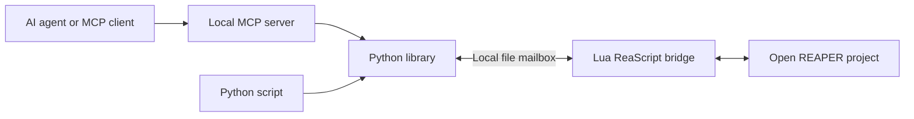

# REAPER Workbench

**Agent-driven mixing, reference comparison and audio timing in REAPER.**

[Русская версия](README.ru.md) · [Installation](docs/INSTALLATION.md) · [MCP guide](docs/MCP-README-LLM.md)

Give an AI agent your REAPER project and a reference track. It can measure
how your mix differs, apply mix decisions in REAPER, and render again to
check what those changes did. The same tools can investigate and correct
performance timing down to individual attacks and crossfades.

Why does the bass disappear when the chorus guitars come in? Is a riff
dragging against the click, or did the detector pick the wrong edge of a note?
REAPER Workbench gives an AI agent the audio and project context to investigate
questions like these. It can render a specific passage through REAPER, compare
sources in time and frequency, follow an exact attack back to the clean take,
and measure what changed after an edit.

Workbench connects **three kinds of evidence in the same session**: the sound
REAPER renders, the project state that produced it, and the changes written
back to the DAW. It exposes them through a local MCP server and a Python library.

## Mix toward a reference

Compare a project render with one or more reference tracks. Choose full
files or specific excerpts independently of the project timeline. For
example, compare your chorus with a similarly dense section of a reference
and inspect differences in loudness, dynamics, frequency balance and stereo
width.

The agent can use those differences to choose and apply changes to levels,
panning or FX, then re-render the same passage and compare it again. The
reference gives the mix a direction. The agent can use the individual tracks
and their routing to decide where to make a change, and the edits remain
available for auditioning and adjustment in REAPER.

[Reference excerpts and project analysis](docs/MCP-README-LLM.md)

## Analyze the mix that actually plays

- **Measure the passage and processing stage that matter.** Workbench renders
  selected sources and time ranges in REAPER. It records the stage alongside
  the result, so a track routed through the master and a master render stay
  distinguishable. Compare loudness, peaks, transient metrics, frequency
  bands and stereo relationships in context.
- **Find where sources compete.** Look at time-resolved band levels and
  relative dominance across sources, or compare phase and stereo evidence.
  For example, inspect the bass and guitars on the exact bars where the bass
  recedes. Band overlap can point to a passage worth auditioning. Source
  loudness attribution has a separate reconstruction check that can withhold
  the estimate when the source renders fail to account for the declared mix.
- **Find out what an edit did to the audio.** Render and measure the same
  passage at the same stage before and after a change. Workbench can compare
  stored analyses down to the individual time-series measurements, so an
  improvement in one section stays visible alongside a regression elsewhere.

[Measurement and mix evidence](docs/MCP-README-LLM.md) · [Loudness reconstruction check](docs/PARTIAL-LOUDNESS-GATE.md)

## Analysis catalog

The core audio report contains **24 scalar metrics**, plus frequency-band
profiles, time series and short-event reports. You can measure a whole track
or a selected passage, from one source up to the mix. Reference comparisons
return deltas for compatible scalar metrics, with units and coverage. When
you supply several references, each metric also gets a reference median and
median absolute deviation. Open the separate band profiles and time series
to see *where* differences occur.

### Measurements in the audio report

| What to compare | Metrics and what they show |
| --- | --- |
| **Overall loudness and dynamics** | `integrated_lufs` measures program loudness; `loudness_range_lu` measures variation over the passage; `rms_dbfs` measures average signal level; `crest_db` measures how far the sample peak rises above RMS. |
| **Peaks and signal integrity** | `peak_dbfs` is the highest sample level; `true_peak_estimate_dbfs` estimates intersample peaks; `clipped_sample_count` and `clipped_sample_ratio` show the count and fraction of clipped samples; `clipping_event_count` counts detected clipping events; `dc_offset` measures the signal's offset from zero. |
| **Frequency balance** | `spectral_centroid_hz` describes where spectral energy is centered. `band_level_dbfs` tracks energy in **28 third-octave bands**, with an average profile and a separate time series (`band_level_time_dbfs`). `reaper_measure` can also report octave bands or caller-selected frequency ranges. |
| **Stereo and mono compatibility** | `stereo_correlation` measures similarity between left and right; `side_mid_db` measures the side-to-mid level ratio; `mono_fold_loss_db` measures level lost when folding to mono. |
| **Attacks and short events** | `transient_count` and `transient_density_per_s` describe transient activity; `two_ms_event_count`, `onset_count` and `spike_count` summarize the short-event detector and provide leads for closer inspection. |
| **Tempo, modulation and pitch** | `local_tempo_median_bpm` summarizes usable local tempo estimates; `modulation_rate_hz` and `modulation_depth` describe recurring variations in the signal envelope; `pitch_jitter_pct` describes pitch variation where it is measurable; `coarse_speech_band_ratio` estimates speech-band energy as a descriptive proxy. |

The time series add a 400 ms RMS curve, band curves and a temporal profile
with local attack and decay, spectral flux, spread, flatness and rolloff,
fundamental pitch and harmonic-to-noise ratio, stereo width, pan and
coherence where available. An attack or a short noisy event can be investigated in the
source even when the average over a whole song barely changes.

### Scoped analyzers and comparisons

| Analyzer ID | What it adds |
| --- | --- |
| `metrics` | Per-source measurements, curves and measurement context for the requested intervals. |
| `temporal_profile` | Individual profile cells with source and time coordinates. |
| `band_balance` | Compare band energy across sources at aligned measured times. |
| `masking` | Report where one source dominates another in the same band at the same time, as evidence for auditioning. |
| `phase` | Compare selected pairs using correlation, relative delay, band-level phase evidence and the level change when summed. |
| `partial_loudness` | Estimate per-source contributions when the source renders pass the mix reconstruction check. |
| `mix_evidence` | Collect measured findings and open questions. For compatible stored analyses, compare exact changed cells before and after an edit. |

That gives the agent several ways to test the same mixing decision. If the
chorus is close to the reference in LUFS but still feels crowded, inspect
the band balance and source overlap in that passage. If a panning change
improves the stereo image, also check the mono fold and what happened on the
master. Coverage tells the agent which comparisons the available audio
supports.

`reaper_capabilities(mode="tools")` exposes the current analyzer catalog.
Use `reaper_analyze` for project and reference analysis and `reaper_measure`
for a targeted source-by-interval measurement table. [MCP analysis guide](docs/MCP-README-LLM.md)

## Find the attack, then decide how to move it

Compare clean DI waveforms against the project tempo map and click. The timing
tools surface alternative rhythms, candidates without a target and residual
errors that a good median can hide. Zoom into the source between detected
events to find a missed pick, then trace that same front through the plan and
every fade that touches it.

Once a decision is made, preview a dry A/B and apply the edit as **native REAPER
clips and crossfades at 1×**. The original amp chain is still available for
auditioning. The result can be checked one attack at a time in the saved
geometry, including whether a seam lets an earlier copy of the attack through.

[Audio timing and guitar examples](docs/TIMING.md)

## Keep the analysis tied to the project

A project context includes the arrangement, tempo, routing, FX and revision.
Measured facts carry their source, interval and freshness. On the next pass
the agent can request what changed, reuse valid measurements and refresh the
ones affected by an edit. Verified edits return the values read back from
REAPER and a receipt for supported undo operations.

The same connection also supports asynchronous capture, reference import,
MIDI and automation edits, and audio encoding with a post-codec true-peak
check.

## How it connects



The Lua bridge runs inside REAPER. The MCP server and Python library run
outside it. The client gets structured project data, audio measurements
and edit receipts through the bridge. REAPER can stay in the background.

## Quick start

The bridge is documented and tested on **Windows**. You need REAPER with
ReaScript and **Python 3.13+**. An MCP client is optional for Python-only use.

```powershell
git clone https://github.com/LunarTrout/reaper-workbench.git
Set-Location reaper-workbench
py -3.13 -m venv .venv
.\.venv\Scripts\python.exe -m pip install -e ".[mcp]"
```

1. In REAPER, open the project, load [the Lua bridge](scripts/reaper_bridge.lua)
   from the Actions window and run it. Keep [its JSON helper](scripts/lua_json.lua)
   in the same directory as the bridge.
2. In your MCP client, point the server command at the virtual environment's
   Python. Replace the example path with the location of your clone.

   ```json
   {
     "mcpServers": {
       "reaper-workbench": {
         "command": "C:\\path\\to\\reaper-workbench\\.venv\\Scripts\\python.exe",
         "args": ["-m", "reaper_audio.mcp_server"]
       }
     }
   }
   ```

3. Have the client read `reaper://handbook` through MCP before measuring or
   editing. Check the connection with `reaper_session(action="health")` and
   `reaper_project`. For timing work, also read `reaper://guide/timing`.

[Full installation and connection guide](docs/INSTALLATION.md)

### Try a read-only request first

> Tell me which REAPER project is open, summarize the routing of the guitar
> tracks, and show what has already been measured. Leave the project as it is.

For exact call schemas, use the client's `tools/list` and the capability
map from `reaper_capabilities(mode="tools")`.

## Documentation

- [Handbook](docs/HANDBOOK.md) and [MCP guide for agents](docs/MCP-README-LLM.md)
- [Audio timing, missed attacks and local refinements](docs/TIMING.md)
- [Measurement policy](docs/POLICY.md), [partial loudness](docs/PARTIAL-LOUDNESS-GATE.md) and [safety](docs/SAFETY.md)
- Optional audio model integrations: [Flamingo](docs/flamingo.md) and [Ossicle](docs/ossicle.md)

## Development

```powershell
.\.venv\Scripts\python.exe -m pip install -e ".[dev,mcp]"
.\.venv\Scripts\python.exe -m pytest -q
```

The offline suite uses simulated bridges and test audio. Live REAPER checks
are separate. Optional model weights are downloaded separately and subject
to their own licenses.
