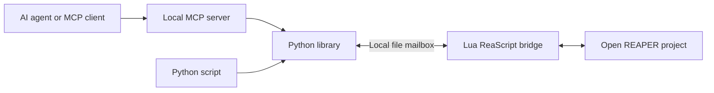

# REAPER Workbench

**A local bridge between an AI agent and a live REAPER session.**

[Русская версия](README.ru.md) · [Installation](docs/INSTALLATION.md) · [MCP guide](docs/MCP-README-LLM.md)

Give an MCP client access to the project you already have open in REAPER.
It can inspect the arrangement, routing and FX, measure the audio REAPER
actually renders, and make edits you can open, listen to and adjust in the DAW.
Python scripts can use the same library directly.

For example, ask an agent to **check why a guitar riff drifts against the
click**. It can inspect the clean DI around a missed attack, compare grid
interpretations, preview an edit, and apply it as ordinary REAPER clips
with crossfades at 1× playback speed. You can audition the result with the
original amp chain and see precisely what changed. [Audio timing guide](docs/TIMING.md)

## What you can do

| Task | What Workbench provides |
| --- | --- |
| **Understand the open project** | Track and item identities, timeline, tempo, routing, FX and project health. Read a compact context or request only what changed. |
| **Investigate a mix** | Measure the selected sources and time ranges through REAPER. Compare loudness, peaks, frequency bands, stereo balance and other metrics at the relevant processing stages. |
| **Edit audio timing** | Examine clean source waveforms, compare local rhythm hypotheses, add missed attacks manually and refine specific seams. Preview a dry A/B, then create native clips and crossfades. |
| **Make and verify edits** | Preview and apply typed changes to tracks, FX, sends, items, automation and MIDI. Receipts bind edits to a project revision and record the values read back from REAPER. Undo is available for supported transactions. |
| **Keep evidence across passes** | Project state records measured facts and their freshness. An agent can reuse measurements it already has and see which facts need to be refreshed after a change. |

There are also tools for asynchronous audio capture, importing references
and encoding audio with a post-codec true-peak check.

## How it connects



The Lua bridge runs inside REAPER. The MCP server and Python library run
outside it. The client gets structured project data, audio measurements
and edit receipts through the bridge. REAPER can stay in the background.

## Quick start

The bridge is documented and tested on **Windows**. You need REAPER with
ReaScript and **Python 3.13+**. An MCP client is optional for Python-only use.

```powershell
git clone https://github.com/LunarTrout/reaper-workbench.git
Set-Location reaper-workbench
py -3.13 -m venv .venv
.\.venv\Scripts\python.exe -m pip install -e ".[mcp]"
```

1. In REAPER, open the project, load [the Lua bridge](scripts/reaper_bridge.lua)
   from the Actions window and run it. Keep [its JSON helper](scripts/lua_json.lua)
   in the same directory as the bridge.
2. In your MCP client, point the server command at the virtual environment's
   Python. Replace the example path with the location of your clone.

   ```json
   {
     "mcpServers": {
       "reaper-workbench": {
         "command": "C:\\path\\to\\reaper-workbench\\.venv\\Scripts\\python.exe",
         "args": ["-m", "reaper_audio.mcp_server"]
       }
     }
   }
   ```

3. Have the client read `reaper://handbook` through MCP before measuring or
   editing. Check the connection with `reaper_session(action="health")` and
   `reaper_project`. For timing work, also read `reaper://guide/timing`.

[Full installation and connection guide](docs/INSTALLATION.md)

### Try a read-only request first

> Tell me which REAPER project is open, summarize the routing of the guitar
> tracks, and show what has already been measured. Leave the project as it is.

For exact call schemas, use the client's `tools/list` and the capability
map from `reaper_capabilities(mode="tools")`.

## Documentation

- [Handbook](docs/HANDBOOK.md) and [MCP guide for agents](docs/MCP-README-LLM.md)
- [Audio timing, missed attacks and local refinements](docs/TIMING.md)
- [Measurement policy](docs/POLICY.md), [partial loudness](docs/PARTIAL-LOUDNESS-GATE.md) and [safety](docs/SAFETY.md)
- Optional audio model integrations: [Flamingo](docs/flamingo.md) and [Ossicle](docs/ossicle.md)

## Development

```powershell
.\.venv\Scripts\python.exe -m pip install -e ".[dev,mcp]"
.\.venv\Scripts\python.exe -m pytest -q
```

The offline suite uses simulated bridges and test audio. Live REAPER checks
are separate. Optional model weights are downloaded separately and subject
to their own licenses.
