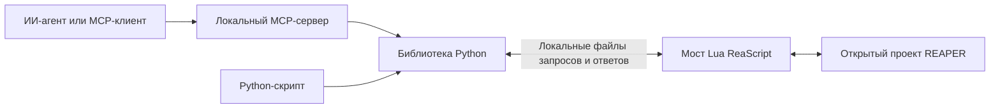

# REAPER Workbench

**Локальный мост между ИИ-агентом и открытым проектом REAPER.**

[English](README.md) · [Установка](docs/INSTALLATION.ru.md) · [Справка MCP](docs/MCP-README-LLM.md)

Подключи MCP-клиент к проекту, который уже открыт в REAPER. Агент сможет
изучить аранжировку, маршрутизацию и эффекты, измерить звук, который
действительно рендерит REAPER, и внести правки, которые можно открыть,
послушать и поправить в DAW. Та же библиотека доступна напрямую из Python.

Например, попроси агента **разобраться, где гитарный рифф расходится с кликом**.
Он может изучить чистый DI вокруг пропущенного удара, сравнить варианты сетки,
предпрослушать правку и применить её обычными айтемами REAPER с кроссфейдами
при скорости 1×. Результат можно послушать с исходной цепочкой усилителя и
посмотреть, где именно изменился монтаж. [Гайд по таймингу](docs/TIMING.ru.md)

## Что умеет

| Задача | Что даёт Workbench |
| --- | --- |
| **Разобраться в открытом проекте** | Дорожки и айтемы с их идентификаторами, таймлайн, темп, маршрутизация, FX и состояние проекта. Можно запросить краткий контекст или только изменения. |
| **Разобрать микс** | Измерения выбранных источников и отрезков через REAPER. Можно сравнить громкость, пики, частотные полосы, стереобаланс и другие метрики на нужных этапах обработки. |
| **Выровнять аудио** | Просмотр чистой волны, сравнение ритмических гипотез, ручное добавление пропущенных атак и уточнение стыков. Сухое A/B и монтаж нативными клипами с фейдами. |
| **Внести и проверить правки** | Предпросмотр и применение правок дорожек, FX, сендов, айтемов, автоматизации и MIDI. Квитанции связывают операции с ревизией проекта и фиксируют фактические значения после записи. Поддерживаемые операции можно отменить. |
| **Сохранять измерения между проходами** | Состояние проекта хранит измеренные факты и показывает, какие из них устарели после правок. Агент может переиспользовать актуальные данные. |

Также доступны асинхронный захват аудио, импорт референсов и кодирование
с проверкой true peak после кодека.

## Как это подключается



Lua-мост работает внутри REAPER. MCP-сервер и библиотека Python работают
отдельным процессом. Клиент получает через мост данные проекта, измерения
и квитанции правок. REAPER может оставаться в фоне.

## Быстрый старт

Мост документирован и проверен на **Windows**. Нужны REAPER с ReaScript и
**Python 3.13+**. Для работы напрямую из Python MCP-клиент необязателен.

```powershell
git clone https://github.com/LunarTrout/reaper-workbench.git
Set-Location reaper-workbench
py -3.13 -m venv .venv
.\.venv\Scripts\python.exe -m pip install -e ".[mcp]"
```

1. Открой проект в REAPER, загрузи [Lua-мост](scripts/reaper_bridge.lua) через
   окно Actions и запусти его. [JSON-помощник](scripts/lua_json.lua) должен
   лежать рядом со скриптом моста.
2. В настройках MCP-клиента укажи Python из виртуального окружения.
   Замени путь из примера на путь к своей копии репозитория.

   ```json
   {
     "mcpServers": {
       "reaper-workbench": {
         "command": "C:\\path\\to\\reaper-workbench\\.venv\\Scripts\\python.exe",
         "args": ["-m", "reaper_audio.mcp_server"]
       }
     }
   }
   ```

3. Перед измерениями и правками агент читает `reaper://handbook` через MCP.
   Подключение можно проверить через `reaper_session(action="health")` и
   `reaper_project`. Для тайминга есть отдельный ресурс `reaper://guide/timing`.

[Полная инструкция по установке и подключению](docs/INSTALLATION.ru.md)

### Первый запрос для проверки

> Скажи, какой проект REAPER открыт. Покажи маршрутизацию гитар и какие
> измерения уже есть. Оставь проект как есть.

Точные схемы вызовов доступны через `tools/list`, карта возможностей —
через `reaper_capabilities(mode="tools")`.

## Документация

- [Руководство](docs/HANDBOOK.ru.md) и [английская справка MCP для агентов](docs/MCP-README-LLM.md)
- [Тайминг, пропущенные атаки и точечные правки](docs/TIMING.ru.md)
- [Политика измерений](docs/POLICY.md), [partial loudness](docs/PARTIAL-LOUDNESS-GATE.md) и [безопасность](docs/SAFETY.ru.md)
- Опциональные аудиомодели: [Flamingo](docs/flamingo.md) и [Ossicle](docs/ossicle.md)

## Разработка

```powershell
.\.venv\Scripts\python.exe -m pip install -e ".[dev,mcp]"
.\.venv\Scripts\python.exe -m pytest -q
```

Офлайн-тесты используют имитацию моста и тестовое аудио. Проверки на живом
REAPER проводятся отдельно. Веса аудиомоделей загружаются отдельно и
распространяются на условиях собственных лицензий.
