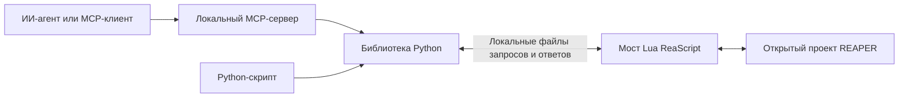

# REAPER Workbench

**Сведение с ИИ-агентом, сравнение с референсами и выравнивание тайминга в REAPER.**

[English](README.md) · [Установка](docs/INSTALLATION.ru.md) · [Справка MCP](docs/MCP-README-LLM.md)

Дай агенту свой проект REAPER и референс. Он может измерить, чем
отличается твой микс, внести изменения в REAPER и снова отрендерить
звук, чтобы проверить результат. Этими же инструментами можно разбирать
и выравнивать исполнение вплоть до отдельного удара и стыка.

Почему бас теряется, когда в припеве вступают гитары? Почему рифф звучит
позади клика, хотя по цифрам атаки в сетке? REAPER Workbench даёт ИИ-агенту
звук и контекст проекта, чтобы разбирать такие вопросы. Агент может
отрендерить нужный фрагмент через REAPER, сравнить источники по времени и
частотам, найти конкретный удар в чистом тейке и перемерить результат после
правки.

Workbench связывает **три вида данных**: звук, который рендерит REAPER,
состояние проекта, в котором он получился, и правки, записанные обратно в DAW.
Всё это доступно через локальный MCP-сервер и библиотеку Python.

## Сводить с опорой на референс

Сравни рендер проекта с одним или несколькими референсами. Можно взять
целые треки или выбрать отрывки независимо от таймлайна проекта. Например,
сопоставить свой припев с таким же плотным фрагментом референса и увидеть,
как отличаются громкость, динамика, частотный баланс и ширина стерео.

По этим различиям агент может выбрать, что изменить в уровнях, панораме
или FX, применить правки и повторно сравнить тот же фрагмент с референсом.
Референс задаёт направление, а данные отдельных дорожек и маршрутизации
помогают понять, где вмешаться. Результат можно послушать и поправить
в самом проекте REAPER.

[Как сравнивать проект с фрагментами референсов](docs/MCP-README-LLM.md)

## Разобрать звучание реального микса

- **Измерить нужный отрезок на нужной стадии.** Workbench рендерит выбранные
  источники и интервалы через REAPER. Стадия сохраняется вместе с измерением,
  поэтому можно различить рендер источника через мастер и рендер самого
  мастера. Доступны громкость, пики, транзиенты, частотные полосы и
  характеристики стерео.
- **Найти, где источники конкурируют.** Смотри уровни по полосам во времени,
  относительное преобладание источников, фазовые и стереосоотношения.
  Например, сравни бас и гитары именно на тех тактах, где бас уходит из
  микса. Перекрытие полос указывает, что имеет смысл послушать. Оценка
  вклада в громкость выводится только после отдельной проверки, что
  рендеры источников воспроизводят заявленный микс.
- **Понять, что правка сделала со звуком.** Сравни измерения одного отрезка
  на одной стадии до и после. Workbench сравнивает сохранённые анализы
  вплоть до отдельных отсчётов измерений во времени. Так видно, где стало
  лучше и в каком месте та же правка дала нежелательный эффект.

[Измерения и сравнение микса](docs/MCP-README-LLM.md) · [Проверка вклада в громкость](docs/PARTIAL-LOUDNESS-GATE.md)

## Найти конкретный удар и решить, куда его ставить

Сопоставь чистую волну DI, клик и карту темпа. Инструменты тайминга показывают
варианты ритма, атаки без цели и отдельные промахи, которые скрывает хорошая
медиана. Подозрительное место между отметками детектора можно приблизить,
найти пропущенный щипок и проследить тот же фронт через план и фейды.

Когда решение принято, агент может подготовить сухое A/B и применить правку
**нативными клипами с кроссфейдами на скорости 1×**. Результат можно послушать
через исходную цепочку усилителя. По записанным клипам можно проверить,
куда попал каждый выбранный удар и не пропускает ли стык его раннюю копию.

[Тайминг и примеры гитарного монтажа](docs/TIMING.ru.md)

## Связать анализ с состоянием проекта

Контекст содержит аранжировку, темп, маршрутизацию, FX и ревизию проекта.
Измерения сохраняют источник, интервал и актуальность. На следующем проходе
агент может запросить только изменения, переиспользовать актуальные
измерения и обновить то, на что повлияла правка. После записи Workbench
перечитывает значения из REAPER и возвращает квитанцию для поддерживаемых
операций отмены.

Через то же подключение доступны асинхронный захват аудио, импорт референсов,
правки MIDI и автоматизации и кодирование с проверкой true peak после кодека.

## Как это подключается



Lua-мост работает внутри REAPER. MCP-сервер и библиотека Python работают
отдельным процессом. Клиент получает через мост данные проекта, измерения
и квитанции правок. REAPER может оставаться в фоне.

## Быстрый старт

Мост документирован и проверен на **Windows**. Нужны REAPER с ReaScript и
**Python 3.13+**. Для работы напрямую из Python MCP-клиент необязателен.

```powershell
git clone https://github.com/LunarTrout/reaper-workbench.git
Set-Location reaper-workbench
py -3.13 -m venv .venv
.\.venv\Scripts\python.exe -m pip install -e ".[mcp]"
```

1. Открой проект в REAPER, загрузи [Lua-мост](scripts/reaper_bridge.lua) через
   окно Actions и запусти его. [JSON-помощник](scripts/lua_json.lua) должен
   лежать рядом со скриптом моста.
2. В настройках MCP-клиента укажи Python из виртуального окружения.
   Замени путь из примера на путь к своей копии репозитория.

   ```json
   {
     "mcpServers": {
       "reaper-workbench": {
         "command": "C:\\path\\to\\reaper-workbench\\.venv\\Scripts\\python.exe",
         "args": ["-m", "reaper_audio.mcp_server"]
       }
     }
   }
   ```

3. Перед измерениями и правками агент читает `reaper://handbook` через MCP.
   Подключение можно проверить через `reaper_session(action="health")` и
   `reaper_project`. Для тайминга есть отдельный ресурс `reaper://guide/timing`.

[Полная инструкция по установке и подключению](docs/INSTALLATION.ru.md)

### Первый запрос для проверки

> Скажи, какой проект REAPER открыт. Покажи маршрутизацию гитар и какие
> измерения уже есть. Оставь проект как есть.

Точные схемы вызовов доступны через `tools/list`, карта возможностей —
через `reaper_capabilities(mode="tools")`.

## Документация

- [Руководство](docs/HANDBOOK.ru.md) и [английская справка MCP для агентов](docs/MCP-README-LLM.md)
- [Тайминг, пропущенные атаки и точечные правки](docs/TIMING.ru.md)
- [Политика измерений](docs/POLICY.md), [partial loudness](docs/PARTIAL-LOUDNESS-GATE.md) и [безопасность](docs/SAFETY.ru.md)
- Опциональные аудиомодели: [Flamingo](docs/flamingo.md) и [Ossicle](docs/ossicle.md)

## Разработка

```powershell
.\.venv\Scripts\python.exe -m pip install -e ".[dev,mcp]"
.\.venv\Scripts\python.exe -m pytest -q
```

Офлайн-тесты используют имитацию моста и тестовое аудио. Проверки на живом
REAPER проводятся отдельно. Веса аудиомоделей загружаются отдельно и
распространяются на условиях собственных лицензий.
