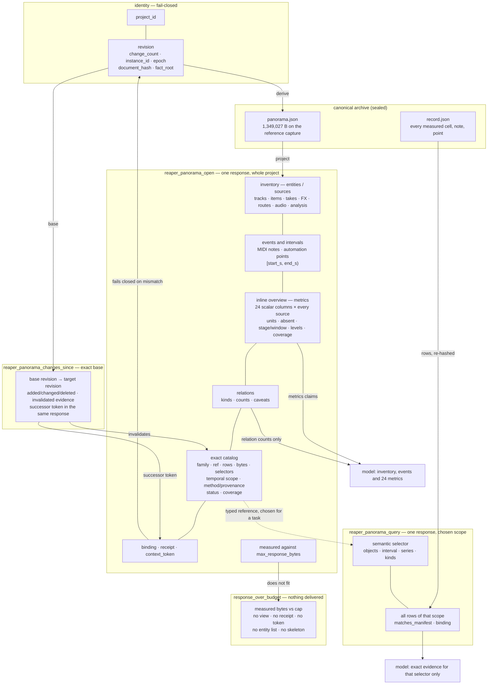

# LLM-facing MCP interface without pages — design and evidence

Status: **research + target contract, not implemented.** No production code, MCP README or test was
changed for this document. This edit changed only this file. Nothing here should be read as
"already shipped"; §12 lists the exact files a later implementation would touch.
Date: 2026-11-14. Repository: `reaper-audio-library`, branch `main`, worktree dirty (28 modified,
58 untracked at the time of writing).

Evidence labels used throughout:

| label | meaning |
|---|---|
| **[OWNER]** | a statement written by the project owner (quoted verbatim where possible) |
| **[DECISION]** | a recorded design decision, possibly assistant-authored; binding only until the owner contradicts it |
| **[CODE]** | verified by reading `src/` at the given path/line today |
| **[MEASURED]** | produced by a read-only run on 2026-11-14; method named next to the number |
| **[SOURCE]** | an external primary source fetched 2026-11-14 (URL in §8) |
| **[INFERENCE]** | my reasoning, not directly stated by any source |
| **[UNVERIFIED]** | asserted by a document but not checked, or not checkable here |

---

## 1. Short decision

**One call returns one whole-project panorama, or a measured refusal. There are no pages, no
scoped-panorama fallback, no skeleton, no scope index and no ordered traversal.**

Owner clarification for this edit (2026-11-14) **[OWNER]**:

> «Семантический scope — допустим только как добровольный, осмысленный выбор под конкретную
> задачу, а не обязательный fallback, чтобы дочитать остальную панораму.»

> "A semantic scope is admissible only as a voluntary, meaningful choice for a specific task, not
> as a mandatory fallback to finish reading the rest of the panorama."

That clarification decides the shape of this document. A narrowing selector is allowed when a task
needs exact rows. It is never the mechanism by which an incomplete panorama is completed, and the
server never organises selectors into a sequence.

### 1.1 Four promises that the word "complete" must not hide

The previous draft used one word, `complete`, for four different things. That is how a response could
look complete while the model had received no exact rows. The target contract names all four
separately, as four named fields, and repeats them in every response.

| id | promise | target field | what is actually in the model's context after this call |
|---|---|---|---|
| **P1** | **Project inventory is complete** | `completeness.project_inventory_complete: true` | every track (including master), item, take, FX chain, route/send, automation envelope, audio asset and analysis source appears exactly once with a stable id; no entity is absent without a declared omission |
| **P2** | **Inline overview and all 24 scalar values are complete** | `completeness.overview_metrics_complete: true` | one row per source carrying all **24** scalar metric columns, a unit for **each**, `null` plus an absent count where not measured, stage/window/method/provenance, **per-metric method/version in `analysis.metric_methods`**, **explicit source identities in `analysis.source_ids`**, both declared temporal levels, relation kinds with counts and caveats, and coverage |
| **P3** | **Exact families are catalogued and addressable** | `completeness.archive_families_addressable: true` | every exact-only family is named with a **typed `ref`**, `rows`, `row_unit`, `bytes`, `selectors`, `temporal_scope`, `method`, `provenance`, a truthful delivery `status` (`archived_not_delivered`, `empty`, or a declared mixed status where part of the family is inline) and a **coverage status** (`complete`, `partial`, `truncated`, `unavailable`); the model knows the family exists and how to ask for it, but has not received its rows |
| **P4** | **Delivered exact rows are complete for the selector** | `completeness.exact_scope_delivered: true` (query response only) | every row of the semantic scope the model chose is in this response, re-hashed against the sealed manifest; or the query refuses with its measured size |

These four fields are the only completeness claims. There is no single `complete` boolean that stands
for all of them: `true` asserts the named dimension for this response, `false` asserts that the
dimension is not met or not delivered, and `null` means this response does not assert it at all. A
query response is not a panorama and does not assert P1–P3; a panorama delivers no exact rows and
always states `exact_scope_delivered: false`.

Consequences that follow directly:

* a panorama response has `exact_scope_delivered: false` and `exact_scope.state: none`; it contains
  **no** series cells, MIDI notes, envelope points or relation edges;
* a query response sets `project_inventory_complete`, `overview_metrics_complete` and
  `archive_families_addressable` to `null` (`reason: not_repeated`); it cannot support whole-project
  claims;
* `coverage.state: complete` means only "no declared domain is missing or truncated"; it never means
  "every exact row was delivered";
* the receipt binds the panorama bytes, not the exact rows and not the model's reading of either.

### 1.2 What one call returns

| situation | one call returns | P1 | P2 | P3 | P4 |
|---|---|---|---|---|---|
| ordinary project fits (measured: 41 tracks, 42 sources, 44,719 B of 48,000) | the whole-project panorama (inventory + inline 24-metric overview + exact-family catalog; **no exact-family rows**), binding, receipt and token | true | true | true | false |
| the project does not fit | `status: response_over_budget`, measured total and per-section bytes, the selector vocabulary and the genuinely semantic groups that exist (a folder/bus subtree, master + its senders) as **optional choices**; no view, no skeleton, no entity list, no receipt and no handle/token | false | false | false | false |
| a voluntary exact query fits | all rows of the chosen semantic scope, binding, `matches_manifest` and the `exact_scope` block | null | null | null | true |
| that exact query does not fit | `status: query_too_large`, measured bytes, the refused selector; coarser `resolution_s` or an explicitly requested smaller interval may be named as voluntary alternatives | null | null | null | false |

**In this document, "panorama" means P1+P2+P3**: the complete inventory, the inline 24-metric
overview and both temporal levels, and the complete catalog of exact families. It does **not** mean
P4 (all raw cells). If "full panorama" is read as "every raw time-series value in one response",
that is option R1 in §14.1 and is not satisfied by this contract; the document does not relabel R2
as R1. A `complete` in a P-column is **dimension-qualified**: it never means the response is
globally complete, and no single field says so.

**No row of this table promises that all raw points of an arbitrarily large project arrive in one
response.** That promise cannot be kept under any finite per-result limit (§10.1–§10.2). For an
ordinary project the panorama fits; for a larger one the server refuses rather than paginates,
truncates or silently downsamples.

### 1.3 Call scheme (the only model-visible panorama calls)

```
reaper_capture_snapshot(project_id, expected_revision, archive_root)      # once per revision
reaper_panorama_open(project_id, expected_revision, archive_root, max_response_bytes=...)  # whole project only; optional budget override, clamped server-side
reaper_panorama_query(handle, revision, archive_root, panorama_receipt,
                      data=[...], objects=[...], interval=...,
                      series=[...], kinds=[...], resolution_s=...)         # exact rows, whole
reaper_panorama_changes_since(project_id, archive_root, base_*, context_token)
reaper_panorama_refresh(project_id, archive_root)                         # whole project only
reaper_panorama_status(project_id, archive_root, handle)
```

There is deliberately **no `scope` parameter on `open` and no `scope` parameter on `refresh`**. A
scoped panorama was the previous draft's fallback: it returned one region plus "the rest of the
project" as a skeleton, which is exactly the page-like completion path this edit removes. A region
overview is not offered. When a task needs data about a region, `reaper_panorama_query` returns the
exact rows for that semantic selector, whole.

`reaper_panorama_query` is a task tool, not a reconstruction tool. A sequence of queries does not
rebuild the panorama, and the server never presents a set of queries as a full-view workflow.

There is no `page`, `cursor`, `next`, `ack`, `offset`, `scope_index` or ordinal anywhere in the
schema, and no response ever tells the model to fetch "the rest".

### 1.4 Why this is not pagination under a new name

* a page is an arbitrary transport slice whose only meaning is "the next bytes"; a query selector is
  a semantic selection (`objects`, `interval`, `series`, `kinds`) chosen for a task;
* pages must be assembled to become meaningful; a query response is complete for its selector and is
  **not a piece of the panorama** — it does not combine with other query responses into one;
* pages have a fixed order and a required completion ceremony; queries have no order, no cursor and
  no acknowledgement;
* there is no skeleton delivered first, no omitted list of "the rest", and no computed index of
  regions. An over-budget response delivers nothing;
* the server never invents synthetic track ranges or sequential interval partitions. If a selector
  is needed, the model names objects or an interval; the server does not propose a walk.

There is also no hidden host-side or server-side context store that the model is expected to
remember. The only cross-call state is an ordinary server-minted `handle`/`receipt`/`context_token`
passed as a tool argument; it names a revision, not unread rows, and every response is self-describing
without it.

---

## 2. What the history actually decided

The transport and the format were settled at different times, by different authors. Conflating them
is what produced the round-6/round-7 churn.

| when / status | artifact | what it says |
|---|---|---|
| 2026-11-13 **[OWNER]** | `docs/research/round-6/PANORAMA-CONTINUITY-RESEARCH-DISPATCH.md:104-116` | "The primary deliverable must work from Codex, Hermes, and other conforming MCP clients. A Hermes ContextEngine, plugin, private API, context hook, or chat-specific harness is explicitly out of scope and rejected." |
| 2026-11-13 **[OWNER]** | same `:120-131` | Initial open = complete unified panorama with identity, revision, root, coverage; deltas since an explicit base; explicit full resync; "No silent patch". |
| 2026-11-13 **[OWNER]** | same `:138-140` | "The owner rejects a reduced panorama that replaces the existing 30-second temporal level with a coarser 300-second level or otherwise hides fine-grained temporal facts… A smaller representation may remove only provably redundant or derivable encoding… The 20,838-byte reduced 'spine' is not an acceptable default." |
| 2026-11-13 **[OWNER]** | same `:142-144` | "Do not expose a disconnected set of JSON files or manually unfolded hierarchy… Do not declare normalized JSON, prose, tables, or another format the winner without task-based comprehension checks… mark model-facing format as unresolved." |
| 2026-11-13 **[DECISION, superseded]** | `docs/research/round-6/SYNTHESIS-AND-DECISIONS.md:33-52` | D6-01…D6-14; pages accepted at 24,576 B as transport; spine rejected; format open. |
| 2026-11-13 **[DECISION, superseded transport]** | `IMPLEMENTATION-DIRECTIVE.md:26`, `DELTA-CONTINUITY-IMPLEMENTATION-ADDENDUM.md:24-38` | Paged load + ack gate as a blocking requirement. |
| 2026-11-14 **[DECISION, current]** | `docs/DECISION-single-response-panorama.md:1-7,55-78` | One call returns one compact columnar view + receipt + token; pages, cursors and the page tools removed; supersedes the paged decision and the 118 KB draft. |
| 2026-11-14 **[OWNER, this edit]** | owner clarification recorded in §1 | Semantic scope is allowed only as a voluntary task choice, never as a fallback to finish an incomplete panorama. This refines the DECISION's over-budget clause ("semantic scopes that would fit", `DECISION:70-72`): the refusal may name selector kinds as optional choices, but must not compute a scope index, a track-range walk or a sequence of regions. |
| 2026-11-14 **[CODE]** | `src/reaper_audio/mcp_server.py` (26 `@server.tool()` registrations) | Only `open`, `query`, `status`, `changes_since`, `refresh` are panorama-visible; `open` has no `scope` parameter. |
| **open [OWNER]** | dispatch `:142-144` | The *format* was never owner-accepted. The columnar view is an implementation default justified by bytes, not by the comprehension tests the owner asked for. |

Three consequences the rest of this document respects:

1. **The transport is decided**: no mandatory pages, no client loop, no private harness, no scoped
   panorama fallback. The owner rejected that architecture, and the current code matches.
2. **The format is not decided**: this document may propose a shape, but must not claim the owner
   accepted tables/JSON, and must keep the door open for the comprehension test in
   `docs/research/round-6/PANORAMA-CONTINUITY-RESEARCH-DISPATCH.md:144`.
3. **The raw-cell question is not decided**: whether the initial panorama must carry the raw 400 ms /
   time-series cells themselves, or whether typed references with counts and summaries are
   acceptable, is the one owner-level choice this design leaves open (§14.1).

---

## 3. Traceability: requirement → source → reason → current code → status

| # | requirement | source | original reason / invariant | current implementation | status |
|---|---|---|---|---|---|
| R1 | client-agnostic MCP only; no ContextEngine/plugin/hook | dispatch `:104-116`, `:134-136` | a private hook makes the product depend on one harness | plain stdio MCP server, 26 tools (`mcp_server.py`), 5 resource templates, no host-specific code | **met** |
| R2 | one coherent, cross-linked whole-project view; no disconnected files, no manual unfolding | dispatch `:11,142-144`; `TZ.md:23` | the model must not assemble the project from parts | one result with `entities` dictionary + FK tables (`panorama_view.py:242-445`); inventory + overview + catalog, no scoped view | **met in transport, format open** |
| R3 | no lossy "full": keep 30 s *and* 300 s levels, units, provenance, uncertainty, validity; a smaller view may drop only redundant/derivable encoding | dispatch `:138-140`; synthesis D6-04/05 | the 20,838 B spine hid measured facts | 24 metric columns + 24 units + absent counts; both levels with declared aggregation; relations carry method/uncertainty/is_not; exact families catalogued | **met for the inline overview; raw 400 ms cells are catalogued, not inline — owner choice §14.1** |
| R4 | full open → exact-base delta → explicit resync; no silent patch | dispatch `:120-131` | a stale base must not be silently patched | `lifecycle.changes_since` (base checks, `stale_base` reasons), `refresh`, `advance.context_token` | **met in code; delta not measurable on the reference archive** (see §14 item 9) |
| R5 | identity/revision/fact-root/hash binding, fail closed | `ARCHITECTURE.md:24`; `context/identity.py:61-155`; `lifecycle.py:233-341` | path + counter can repeat after a restart | identity gaps refuse; `fact_root`, `document_hash` carried in open and query | **met** |
| R6 | receipt = delivery of bytes, not comprehension | `DECISION:100-103` | the server cannot observe client memory | `delivery.receipt_guarantee` states it; no "read" claim anywhere | **met** |
| R7 | no genre recipe, no better/worse, no mandatory pipeline | `TZ.md:9,11`; dispatch `:22-23` | owner's artistic authority | view adds no role/quality; `reading.epistemic` declares empty layers; relations carry `is_not` | **met** |
| R8 | compact summary + addressable detail, minimal calls | `TZ.md:27,28,61` | agent call budget | 44.7 KB view + one whole-scope query + deltas | **met for the measured project; exact detail is one query, not a sequence** |
| R9 | no page/cursor/ack on the model surface | owner rejection recorded in `DECISION:189`; owner clarification 2026-11-14 | pages require model discipline and a client loop | 5 panorama tools, no `mode`, no `page_bytes`, no `scope` on `open` | **met; two response payloads still *name* removed tools** (GAP-1) |
| R10 | honest over-budget outcome | `DECISION:60-62,161-167`; owner clarification 2026-11-14 | Hermes spills a result above 50,000 chars | `_over_budget` returns measured section bytes, no receipt; target keeps measured refusal and optional selector kinds, no computed scope index | **met in shape; the DECISION's "scopes that would fit" clause is refined by the owner clarification** |
| R11 | coverage and missing data explicit | `TZ.md:23`; `panorama_view.py:718-751` | partial ≠ complete | `coverage.complete`, `domain_count`, `missing`, `truncated`, `incomplete` | **met for coverage; target adds the four completeness fields so coverage cannot stand in for delivery** |
| R12 | exact query binds capture/revision/root/hash | user requirement 2026-11-14 | evidence must be addressable and tamper-evident | query envelope carries all five; rows re-hashed against the sealed manifest | **met** [MEASURED] |
| R13 | resources must not be the required path | owner "no resource fetch" constraint; §8 client evidence | applications decide resource inclusion | resources exist but no model instruction needs them | **met by design; host behaviour verified for 2 hosts** |
| R14 | format decided by comprehension tests | dispatch `:144` | bytes are not comprehension | none run | **open (owner)** |
| R15 | no traversal, no assembly, no synthetic partitions | owner clarification 2026-11-14; this edit | a sequence of regions is a page walk with different names | no `scope` on `open`, no `scope_index`, no track ranges, no interval partitions; exact query is whole or refused | **met by the target contract; current code has no scoped open, so the shape already matches** |
| R16 | four completeness promises declared separately | this document §1.1 | one word hid undelivered data | none; `coverage.complete` is the closest field and it conflates inventory with delivery | **target; not implemented** |

---

## 4. Current flow, as implemented (A)

### 4.1 Steps

| step | tool | contract | code | model sees | size / failure |
|---|---|---|---|---|---|
| discovery | `reaper_capabilities`, `reaper_api_search` | domain index + structured search | `mcp_server.py` | names, schemas, docs | small; no state |
| structural read | `reaper_project` | live revision, tracks/master, routing, tempo | `mcp_server.py` | JSON project map | grows with the project; not the panorama |
| capture | `reaper_capture_snapshot` | append capture, return archive metadata only | `mcp_server.py:2137` | capture_id, archive, counts | renders audio; restores REAPER state |
| initial delivery | `reaper_panorama_open` | whole view + receipt + token, or `response_over_budget`; no `scope` | `mcp_server.py:2350` → `lifecycle.py:1067` → `panorama_view.py:907` | the view | 44,719 B of 48,000 on the reference capture [MEASURED] |
| exact rows | `reaper_panorama_query` | semantic selector → whole fragment or `query_too_large` | `mcp_server.py:2381` → `lifecycle.py:1184` → `query.py:334` | rows + binding + `matches_manifest` | 5,805 B for 100 cells [MEASURED] |
| edit | `reaper_edit` / `reaper_api_call` / `reaper_action` | preview → apply → readback → delta | `mcp_server.py:1196,1294-1331` | delta + `advance.context_token` | ratio to change size |
| delta between captures | `reaper_panorama_changes_since` | exact base → delta + successor token; `stale_base`/`refresh_required` | `lifecycle.py:1240` | added/changed/deleted, invalidations | bounded by the delta horizon |
| resync | `reaper_panorama_refresh` | re-deliver the whole view; no `scope` | `lifecycle.py:1037` | a new view + token | same as open |
| state | `reaper_panorama_status` | sanitized delivery facts | `lifecycle.py:1012` | `delivered`, `receipt`, `view_sha256` | allowlisted; no page fields [MEASURED] |

### 4.2 Canonical archive vs model view vs delivered rows

| layer | what it is | where | integrity | in a panorama response? | in an exact query response? |
|---|---|---|---|---|---|
| canonical record | the sealed capture: every measured row, every note, every envelope point | `captures/<id>/record.json` | `integrity_sha256` | no — source only | rows are read from it and re-hashed |
| canonical panorama document | derived, self-describing, 1,349,027 B on the reference capture | `captures/<id>/panorama.json` | `document_sha256`, binding validated | no — projected | no |
| model view | in-memory projection, 42,864 B | delivered, never stored | `view_sha256` | yes | no |
| exact catalog | metadata about the exact families (rows, bytes, selectors, temporal scope, method/provenance, status) | inside the view | part of `view_sha256` | yes — metadata only | no |
| exact query result | rows for the selected semantic scope, re-hashed against the sealed manifest | response only | `matches_manifest` | no | yes |

The view is a projection, never the authority. Any disagreement is resolved by the document hash.
The catalog is a description of the archive, never a substitute for its rows.

### 4.3 Tools and resources actually advertised

[MEASURED] `tools/list` = **26** tools. Panorama-visible: `reaper_panorama_open`,
`reaper_panorama_query`, `reaper_panorama_status`, `reaper_panorama_changes_since`,
`reaper_panorama_refresh`. `reaper_panorama_page`, `_ack`, `_detail`, `_slice`, `_delta_ack` are
absent.

[MEASURED] `resources/list` = 1, `resources/templates/list` = **5**:
`reaper://capabilities/{domain}`, `reaper://api/{name}`,
`reaper://projects/{bridge_session_id}/{project_id}/context/{change_count}`,
`reaper://analyses/{analysis_id}/report`,
`reaper://analyses/{analysis_id}/audio/{source_guid}`.

**Doc drift:** `docs/MCP-README-LLM.md:3`, `docs/VALIDATION.md:20`, `docs/VALIDATION.ru.md:11`,
`README.md:119`, `README.ru.md:116` all say "6 resource templates". The server advertises 5.
Either a template was removed and the docs were not, or a sixth exists in another code path — either
way the number in the docs is not what `tools/list` shows. [CODE+MEASURED]

### 4.4 What is inline, what is catalogued, and what is actually delivered

| domain | inline in the panorama | catalogued exact family | delivered in the panorama? | exact access | why |
|---|---|---|---|---|---|
| tracks + master | one row each: name, flags, folder, pan, vol, colour, counts, routing indices | — (raw state chunks are `not_addressable`; §11 MUST 5 requires them to be declared) | yes, inventory only | live `reaper_project` for raw state | per-entity, O(n) |
| items / takes | geometry, mute/lock/selection, take ids, media name | `items`, `takes` | inventory rows only | query `items`, `takes` | O(items) |
| FX | per-track chain: name, enabled, preset, param count | `fx` parameters are exact-only but **not a query family today**; target must add one or declare `not_addressable` | chain only, no parameter values | none today | O(fx × params) |
| routes / sends | from→to, mode, gain, pan | — | yes | live `reaper_project` | O(routes) |
| automation / envelopes | count, owner, point count, time basis | `envelope_points` | counts only | query `envelope_points` | O(points) |
| MIDI | take ids, note counts | `midi_notes` | counts only | query `midi_notes` (10,000-note capture cap) | O(notes) |
| audio | asset id, stage, sr, ch, duration, 16-hex SHA prefix | `audio` | inventory rows only | query `audio` for full SHA, frame map, tail samples | 42 assets |
| metrics | 24 scalar columns per source + 24 units + absent counts | `analysis` (exact unrounded values) | yes, all 24 per source, 3 decimals | query `analysis` + `objects` (the advertised `metrics` selector is not implemented — GAP-8) | O(sources × 24) |
| temporal | two declared levels (30 s, 300 s) × sources, count/min/max/mean/p50 | `series` (raw cells) | levels only | query `series` + interval + `resolution_s` | O(sources × levels) |
| relations | kinds, meaning, method, uncertainty, counts, units, coverage rows | `relations` | kinds and counts only | query `relations` for every edge and pair | 840,989 B archived |
| project map | tempo map, signatures, markers, regions, extents | `project_map` | summary only | query `project_map` | small |

The boundary is a rule, not an accident: **anything whose size grows with events is exact-only and
catalogued; anything whose size grows with entities or families is inline.** Catalogued is not
delivered. A catalog row is a typed reference — a family plus a selector — not an ordinal page and not
a piece of a larger document.

### 4.5 Archived, catalogued, delivered, comprehended: four different states

| state | definition | who can check it |
|---|---|---|
| **archived** | the bytes exist in the sealed `record.json` or `panorama.json`, bound by `integrity_sha256` / `document_sha256`; they may or may not have a documented selector | the server |
| **catalogued** | the response names the family, `ref`, `rows`, `row_unit`, `bytes`, `selectors`, `temporal_scope`, `method`, `provenance`, `status` and `coverage`; the model can ask for the rows, but has not received them | the server; visible to the model |
| **delivered** | the bytes are in this response: the view is covered by `view_sha256`; exact rows by `matches_manifest` | the server and the client transport |
| **comprehended** | the model read and retained the bytes | **unobservable**; the server never claims it |

`receipt` means **delivered**, in the sense above. It does not mean catalogued, comprehended, or
"the model can now reason about the whole project". The exact catalog is likewise not a delivery
receipt for the rows it describes.

---

## 5. Measurements (B)

[MEASURED] 2026-11-14 by `work/benchmark/panorama_view/audit_surface.py` (read-only; no test suite
run), on the archived capture `cap_01M79659V69NDC5YNAA0SMPX51`, project `reaper:himmp`,
41 tracks + master, 42 sources.

| quantity | value |
|---|---|
| canonical document | 1,349,027 B |
| model view | 42,864 B |
| full open response | **44,719 B** |
| default budget | 48,000 B |
| headroom | 3,281 B |
| tracks / items / takes / fx / routes / audio | 42 / 34 / 34 / 16 / 40 / 42 |
| analysis rows | 42 |
| metric columns / units | 24 / 24 |
| absent metric values | 24 (integrated_lufs 4, local_tempo_median_bpm 8, loudness_range_lu 4, stereo_correlation 4, true_peak_estimate_dbfs 4) |
| temporal levels | 300 s and 30 s, 42 rows each |
| relation kinds present | `band_dominance` (1,039 edges), `track_master_level_relation` (41 edges) |
| coverage | complete, 10 domains, `missing`/`truncated` empty |
| inventory | 20 canonical sections mapped, 0 unmapped |
| query, one track, `rms_400ms`, 0–10 s | 5,805 B, 100 cells, manifest hash OK |
| query, same, 0–20 s | 8,633 B, 197 cells, manifest hash OK |
| wide query (`series`+`relations`, all objects) | `query_too_large` |
| archive families | relations 2,076 rows / 840,989 B; series 42 / 112,265 B; midi_notes 0; envelope_points 6 / 3,075 B; items 34 / 23,309 B; takes 34 / 12,867 B; audio 42 / 55,450 B; analysis 42 / 112,265 B; project_map 12 / 2,414 B |

**Withdrawn decomposition.** The previous draft printed a per-section table that summed to
**47,913 B** while the same view measured **42,864 B**. The two cannot both be true, and the
derived “≈530 B per source / 65–80 sources” ceiling depended on that table. It is withdrawn. The
authoritative measurements are the totals above: 42,864 B view, 44,719 B response, 3,281 B headroom
on a 42-source project. **No source-count ceiling is asserted from them.** A larger project may or
may not fit; the server measures and refuses.

### 5.1 Reading the numbers against the four promises

* **P1 inventory**: 42 track rows (41 + master), 42 sources, 34 items, 34 takes, 16 FX chains,
  40 routes, 6 envelopes, `unmapped_sections: []`. Every entity that exists has a row.
* **P2 inline overview**: 42 analysis rows × 24 metric columns, 24 units, 24 absent values, two
  temporal levels, 2 relation kinds with counts, 10 coverage domains. The model sees every source and
  every scalar family without a second call.
* **P3 exact catalog**: the exact-only families are relations 2,076 rows / 840,989 B, series 42
  sources / 112,265 B, MIDI 0, envelope points 6 / 3,075 B — **2,124 rows / 956,329 B** in total.
  None of those rows is in the panorama; all are catalogued with counts, bytes and selectors.
  **Byte-basis caveat [CODE]:** the current `archive.catalog` builds the `series` row from
  `entities.analysis`, the same object as the `analysis` row (`panorama_view.py:763-794`). The
  identical 112,265 B is therefore the analysis-row size, not a measurement of the series payload.
  The target must add `bytes_basis` and measure each family's own payload; until then the series
  byte figure is a placeholder and the 1.68 MB extrapolation below is a lower bound, not a
  measurement.
* **P4 exact scope delivered**: one track × `rms_400ms` × 0–10 s returns 5,805 B / 100 cells; 0–20 s returns
  8,633 B / 197 cells. Both are whole for the selector and hash-verified. The wide query
  (`series`+`relations`, all objects) is refused.
* **No all-raw promise**: the series family alone is 112,265 B on a 20 s capture. At 300 s the same
  density is ≈1.68 MB — 35× the 48,000 B cap — before MIDI, envelope points, relation edges or the
  24 scalar columns. [INFERENCE from the measured 20 s series bytes × 15; not measured on a 300 s
  capture.] A response cannot carry that under any finite host limit.

**Not measured here:** a project with 200+ tracks, a project with thousands of items, or a capture
whose analysis density is higher (more levels, more series). §10 explains why no design can promise
those in one result, and what the honest boundary is.

---

## 6. Metrics and relations: what must be inline, what is exact, and why identities matter

### 6.1 The metric census

| family group | count | members | in the panorama | exact access |
|---|---|---|---|---|
| loudness / level | 6 | `integrated_lufs`, `peak_dbfs`, `rms_dbfs`, `true_peak_estimate_dbfs`, `loudness_range_lu`, `crest_db` | scalar columns, 3 decimals | query `analysis` for unrounded values |
| spectrum / tone | 2 | `spectral_centroid_hz`, `coarse_speech_band_ratio` | scalar columns | query `analysis` |
| stereo / phase | 3 | `stereo_correlation`, `side_mid_db`, `mono_fold_loss_db` | scalar columns | query `analysis` |
| dynamics events | 8 | `transient_count`, `transient_density_per_s`, `onset_count`, `two_ms_event_count`, `spike_count`, `clipping_event_count`, `clipped_sample_count`, `clipped_sample_ratio` | scalar columns | query `analysis` |
| modulation / pitch | 3 | `modulation_rate_hz`, `modulation_depth`, `pitch_jitter_pct` | scalar columns | query `analysis` |
| signal hygiene | 1 | `dc_offset` | scalar column | query `analysis` |
| tempo context | 1 | `local_tempo_median_bpm` | scalar column | query `analysis` |
| **total scalar** | **24** | | `analysis.rows` + `analysis.metric_units` + `analysis.absent` + `analysis.metric_methods` | |
| temporal levels | 2 | 30 s, 300 s: count/min/max/mean/p50 per source | `temporal.levels` | query `series` for raw cells |
| exact series | 3 | `rms_400ms`, `band_level`, `temporal_profile` | catalog entry + counts/bytes | query `series` |
| relations | 6 kinds (2 mandatory) | `band_dominance`, `band_dominance_pair`, `phase_pair`, `track_master_level_relation`, `reference_comparison`, `partial_loudness_share` | kind registry + counts + caveats | query `relations` for edges/pairs |
| events | 4 | MIDI notes, envelope points, items, takes | counts + catalog entries | query `midi_notes`, `envelope_points`, `items`, `takes` |

Nothing in this table is dropped from the model's first response as a *family*. What varies is
representation: inline scalar/level/kind data, or a catalog entry whose rows are archived. The catalog
entry is what makes the model not blind to the family.

**The 24-row check.** The table below answers the per-metric question directly. The repeated `no` is
the point: the 24 scalars are inline only; the temporal, series and relation layers are separate
families and are not per-metric tables. `temporal` is `yes` only for `rms_dbfs`, because the two
declared levels are levels of the per-source `rms_400ms` grid (dBFS), not 24 per-metric profiles.

| metric | unit | inline? | temporal levels? | exact time series? | relation rows? |
|---|---|---|---|---|---|
| `clipped_sample_count` | samples | yes, 3 dp | no per-metric | no | no |
| `clipped_sample_ratio` | ratio | yes, 3 dp | no per-metric | no | no |
| `clipping_event_count` | count | yes, 3 dp | no per-metric | no | no |
| `coarse_speech_band_ratio` | ratio | yes, 3 dp | no per-metric | no | no |
| `crest_db` | dB | yes, 3 dp | no per-metric | no | no |
| `dc_offset` | amplitude | yes, 3 dp | no per-metric | no | no |
| `integrated_lufs` | LUFS | yes, 3 dp | no per-metric | no | no |
| `local_tempo_median_bpm` | BPM | yes, 3 dp | no per-metric | no | no |
| `loudness_range_lu` | LU | yes, 3 dp | no per-metric | no | no |
| `modulation_depth` | ratio | yes, 3 dp | no per-metric | no | no |
| `modulation_rate_hz` | Hz | yes, 3 dp | no per-metric | no | no |
| `mono_fold_loss_db` | dB | yes, 3 dp | no per-metric | no | no |
| `onset_count` | count | yes, 3 dp | no per-metric | no | no |
| `peak_dbfs` | dBFS | yes, 3 dp | no per-metric | no | no |
| `pitch_jitter_pct` | % | yes, 3 dp | no per-metric | no | no |
| `rms_dbfs` | dBFS | yes, 3 dp | yes — RMS grid | yes — `rms_400ms` | no |
| `side_mid_db` | dB | yes, 3 dp | no per-metric | no | no |
| `spectral_centroid_hz` | Hz | yes, 3 dp | no per-metric | no | no |
| `spike_count` | count | yes, 3 dp | no per-metric | no | no |
| `stereo_correlation` | correlation | yes, 3 dp | no per-metric | no | no |
| `transient_count` | count | yes, 3 dp | no per-metric | no | no |
| `transient_density_per_s` | events/s | yes, 3 dp | no per-metric | no | no |
| `true_peak_estimate_dbfs` | dBTP | yes, 3 dp | no per-metric | no | no |
| `two_ms_event_count` | count | yes, 3 dp | no per-metric | no | no |

The exact access for every row is `reaper_panorama_query(data=["analysis"], objects=[...])`; it
returns the unrounded values for the selected sources. `band_level` and `temporal_profile` are
separate series families, not scalar columns; if a capture stores a per-metric profile, it is
addressable through `temporal_profile` under that series name. Relation rows are track/master/band
edges and do not carry the 24 scalar columns.

### 6.2 What the inline overview must guarantee

For every inline number the model must be able to answer: **whose** value, **over what interval**,
**at what stage**, **measured how**, **to what precision**, **at which revision**. The target
contract guarantees:

* one `analysis.rows` row per source, including a source with `available: 0` — no source disappears
  because its metrics are null;
* **all 24** metric columns in a fixed order, with `analysis.metric_units` containing **24** entries;
  a missing unit is a contract violation, not a formatting choice;
* `null` means "not measured", never 0; `analysis.absent` counts nulls per metric family, and the
  counts are visible even when the value is absent;
* per-row `stage` and `window` indices, plus `analysis.source_ids` (the stable source id for every
  row), `analysis.metric_methods` with one entry per metric (`unit`, `method`, `method_version`,
  `stage`, `window_basis`, `channel_view`, `decimals`) and a compact `analysis.evidence` block
  (capture, revision, record hash, window, producer/version); if two sources are measured by
  different methods, the table must say so per metric (current gap: only document-level `method`);
* both temporal levels with `width_s`, `aggregation`, `anchor`, `buckets`, `decimals`, `available`
  and a reason when a level is not available, each row carrying a `source` id; a finer level is never
  invented;
* relation kinds with `meaning`, `is_not`, `method`, `method_version`, `uncertainty`, `alternatives`,
  `coverage_rule`, units and edge count — the caveat travels with the count;
* `coverage.state`, `missing`, `truncated`, `incomplete`, `unmapped_sections`;
* `binding` + `delivery` + `view_sha256` binding every inline number to capture, revision, fact root
  and hash.

What the inline overview does **not** guarantee: exact unrounded values, raw 400 ms cells, MIDI notes,
envelope points, relation edges, full 64-hex audio hashes or frame maps. Those are P3 catalog entries,
and P4 delivery happens only in a query.

### 6.3 Relations: measurement, not meaning

The two mandatory relation kinds carry, in the view itself: `meaning`, `is_not[]`, `method`,
`method_version`, `stage_relation`, `uncertainty{status,reason}`, `alternatives[]`, `coverage_rule`,
units and edge count. That is the correct shape: the model gets what was measured, what it is not,
and what else could explain it — without a "good/bad" score and without a causal claim.

The design keeps this and adds nothing interpretive: no ranking of tracks, no "masking" verdict, no
"the guitar fights the vocal".

### 6.4 Why stable identities reduce duplication without loss

* one `entities` dictionary holds every GUID and name once; tables reference rows by integer index
  and keep `<kind>:<guid>` as the stable id;
* FKs (`items.track`, `takes.item`, `takes.track`, `midi.take`, `fx.owner`, `routes.from/to`,
  `automation.owner`, `envelopes.owner`, `audio.source`, `analysis.source`) are *the* cross-links —
  there is no separate crosslink table to drift out of sync;
* the archive catalog addresses exact rows by family + selector, so a 64-hex hash or a 10,000-note
  list never has to be repeated per row;
* a typed reference is not a page: it names a family and a selector, not an ordinal offset or a
  position in a sequence. Two references do not imply an order, and fetching one does not advance a
  cursor;
* because ids are stable across captures, a delta can name `added/changed/deleted` by id and the
  model can patch its picture instead of re-reading it.

---

## 7. One shape for the whole thing



There is no edge from `query` back to `open`, and no edge from `refuse` to any project content. A
sequence of queries is not a path to the panorama; the model chooses a query only when a task needs
exact rows. Identity is a gate on every edge: a mismatch closes the response, and a delta is valid
only from an exact base and carries its successor token in the same response.

Real-shaped excerpt (values from the measured capture; track names neutralised). This is the *form*
a model receives, trimmed to what a reader needs to see; every `…` is present in the real response,
and `completeness.overview_metrics_complete` asserts the 24 columns and 24 units.

```json
{
  "schema_version": "reaper-workbench.panorama-lifecycle/2",
  "status": "delivered",
  "project_id": "reaper:{...}:C:\\...\\project.rpp",
  "capture_id": "cap_01M79659V69NDC5YNAA0SMPX51",
  "revision": {"change_count": 166, "instance_id": "...", "epoch": 1,
               "document_hash": "73736db8…", "fact_root": "fc8f15fb…"},
  "delivery": {"mode": "single_response", "view_schema": "reaper-workbench.panorama-view/3",
               "view_sha256": "6569c899…", "view_bytes": 42864, "response_bytes": 44719,
               "max_response_bytes": 48000, "fits": true, "pages": false,
               "requires_client_reassembly": false},
  "completeness": {
    "project_inventory_complete": true,
    "overview_metrics_complete": true,
    "archive_families_addressable": true,
    "exact_scope_delivered": false,
    "inventory": {"entities": 256, "sources": 42,
                  "by_kind": {"track": 42, "item": 34, "take": 34, "fx": 16,
                              "route": 40, "audio": 42, "analysis": 42, "envelope": 6},
                  "unmapped_sections": []},
    "overview": {"sources": 42, "scalar_metrics": 24,
                 "metric_units": 24, "absent_values": 24,
                 "temporal_levels_s": [300.0, 30.0], "relation_kinds": 2,
                 "coverage": {"state": "complete", "domains": 10,
                              "missing": [], "truncated": []}},
    "archive": {"families": 9,
                "exact_only": {"rows": 2124, "bytes": 956329},
                "note": "catalogued availability; exact rows are not in this response"},
    "exact_scope": {"state": "none", "selector": null, "rows": 0, "bytes": 0,
                    "reason": "panorama carries no exact-family rows"}
  },
  "view": {
    "binding": {"capture_id": "cap_…", "record_schema": "reaper-workbench.full-capture/1",
                "record_integrity_sha256": "3701fbdd…", "revision": {"change_count": 166}},
    "entities": {"track": [["{TRACK-1-GUID}", "Gtr L 1"], ["{TRACK-2-GUID}", "Gtr L 2"]],
                 "item": [["{ITEM-GUID}", "take.wav"]]},
    "tracks": {"columns": ["id","name","folder_depth","mute","solo","vol","pan","item_n",
                           "fx_n","send_n","role"],
               "rows": [[0,"Gtr L 1",0,0,0,0.7,-1.0,1,1,1,null]]},
    "analysis": {
      "rows": {"columns": ["source","available","stage","window",
                           "<24 metric columns, in metric_columns order>"],
               "rows": [[0,1,0,0, "…24 values, 3 decimals…"]]},
      "rows_note": "42 rows; one shown",
      "source_ids": ["track:{TRACK-1-GUID}", "track:{TRACK-2-GUID}", "…42 total…"],
      "source_ids_note": "42 entries; 2 shown plus a total marker",
      "metric_columns": ["clipped_sample_count","clipped_sample_ratio","clipping_event_count",
                         "coarse_speech_band_ratio","crest_db","dc_offset","integrated_lufs",
                         "local_tempo_median_bpm","loudness_range_lu","modulation_depth",
                         "modulation_rate_hz","mono_fold_loss_db","onset_count","peak_dbfs",
                         "pitch_jitter_pct","rms_dbfs","side_mid_db","spectral_centroid_hz",
                         "spike_count","stereo_correlation","transient_count",
                         "transient_density_per_s","true_peak_estimate_dbfs","two_ms_event_count"],
      "metric_units": {"clipped_sample_count":"samples","clipped_sample_ratio":"ratio",
                       "clipping_event_count":"count","coarse_speech_band_ratio":"ratio",
                       "crest_db":"dB","dc_offset":"amplitude","integrated_lufs":"LUFS",
                       "local_tempo_median_bpm":"BPM","loudness_range_lu":"LU",
                       "modulation_depth":"ratio","modulation_rate_hz":"Hz",
                       "mono_fold_loss_db":"dB","onset_count":"count","peak_dbfs":"dBFS",
                       "pitch_jitter_pct":"%","rms_dbfs":"dBFS","side_mid_db":"dB",
                       "spectral_centroid_hz":"Hz","spike_count":"count",
                       "stereo_correlation":"correlation","transient_count":"count",
                       "transient_density_per_s":"events/s",
                       "true_peak_estimate_dbfs":"dBTP","two_ms_event_count":"count"},
      "metric_methods_count": 24,
      "metric_methods": {
        "integrated_lufs": {"unit":"LUFS","method":"analysis.metrics._gated_integrated_loudness",
                            "method_version":"m1","stage":"file_or_buffer",
                            "window_basis":"measured_window","channel_view":"as_captured",
                            "decimals":3},
        "crest_db": {"unit":"dB","method":"analysis.metrics.measure_audio",
                     "method_version":"m1","stage":"file_or_buffer",
                     "window_basis":"measured_window","channel_view":"as_captured",
                     "decimals":3}
      },
      "metric_methods_note": "one entry per metric_columns element; 2 of 24 shown; every entry is non-null and names the producer version",
      "absent": {"integrated_lufs": 4, "local_tempo_median_bpm": 8, "loudness_range_lu": 4,
                 "stereo_correlation": 4, "true_peak_estimate_dbfs": 4},
      "evidence": {"capture_id": "cap_…", "revision": {"change_count": 166,
                   "instance_id": "…", "epoch": 1},
                   "record_integrity_sha256": "3701fbdd…",
                   "window": [0.0, 20.0], "stage": "file_or_buffer",
                   "method": "analysis.measure_audio", "method_version": "m1"},
      "method": {"family": "analysis.measure_audio", "version": "…",
                 "provenance": "sealed record analysis"}
    },
    "temporal": {"stored": {"width_s": 0.8166666666666668, "anchor_s": 0.0, "buckets": 25,
                            "sources": 42},
                 "columns": ["source","buckets","min","max","mean","p50"],
                 "levels": [{"width_s": 300.0, "available": true, "buckets": 1,
                             "aggregation": "mean of stored cells", "decimals": 2,
                             "effective_cell_s": 20.0, "degenerate": true,
                             "rows": [[0, 1, -31.3, -22.1, -26.4, -26.5]]},
                            {"width_s": 30.0, "available": true, "buckets": 1,
                             "effective_cell_s": 20.0, "degenerate": true,
                             "rows": [[0, 1, -31.3, -18.9, -25.2, -25.4]]}],
                 "rows_note": "42 source rows per level; one shown"},
    "relations": {"kinds": [{"kind":"band_dominance","edges":1039,
                             "meaning":"…sits above… in one band over the shared active cells. This is not audibility, not masking, and not an instruction to change either source.",
                             "is_not":["audibility","psychoacoustic masking","causation"],
                             "method":"analysis.relations.band_dominance","method_version":"1",
                             "uncertainty":{"status":"unknown","reason":"…"},
                             "units":{"band_delta_db":"dB"}},
                            {"kind":"track_master_level_relation","edges":41,
                             "meaning":"… arithmetic share of summed solo renders; not a causal contribution through master FX, returns or PDC.",
                             "is_not":["causal contribution","audibility","mix quality"],
                             "method":"analysis.relations.track_master_level","method_version":"1",
                             "uncertainty":{"status":"unknown","reason":"master processing is not invertible"},
                             "units":{"level_delta_db":"dB"}}]},
    "archive": {"catalog": {
      "columns": ["family","ref","rows","row_unit","bytes","selectors","temporal_scope",
                  "method","provenance","status","coverage"],
      "rows": [
        ["relations","family:relations",2076,"edges+pairs+unavailable",840989,
         ["objects","kinds","bands_hz","interval"],"project_extent",
         "analysis.relations.band_dominance","sealed panorama document","archived_not_delivered","complete"],
        ["series","detail:analysis_series",42,"sources",112265,
         ["objects","series","interval","resolution_s"],"0.4 s grid over content_extent",
         "analysis.series.rms_400ms","sealed record detail manifest","archived_not_delivered","complete"],
        ["midi_notes","detail:midi_notes",0,"notes",0,["objects","interval"],"item extent",
         "captured MIDI","sealed record detail manifest","empty","complete"],
        ["envelope_points","detail:envelope_points",6,"points",3075,["objects","interval"],"envelope extent",
         "captured automation","sealed record detail manifest","archived_not_delivered","complete"],
        ["analysis","family:analysis",42,"sources",112265,["objects"],"capture extent",
         "analysis.measure_audio","sealed record analysis",
         "scalars_inline_3dp; exact_unrounded_archived","complete"]
      ],
      "coverage_note": "coverage is complete|partial|truncated|unavailable per family; it is not a delivery claim",
      "bytes_note": "series bytes are currently measured from analysis rows (M-07); the target measures each family's own payload",
      "rows_note": "5 of 9 rows shown; items, takes, audio and project_map are omitted here for length, not from the response",
      "note": "9 families; the catalog names every exact-only family and how to ask for it, not that its rows were delivered"}},
    "coverage": {"state": "complete", "domains": 10, "missing": [], "truncated": []},
    "reading": {"tables": "…", "time": "…",
                "precision": {"inline_metrics":"3 decimals", "…":"…"},
                "epistemic": {"interpretations":"empty: no role, genre, quality or preference inferred",
                              "hypotheses":"empty: no cause asserted by this view"}}
  },
  "receipt": "pr_…",
  "context_token": "ct_…",
  "audio_evidence": {"state": "current"},
  "next_action": "exact rows only when a task needs them: reaper_panorama_query with a semantic selector; edits: this context_token"
}
```

What is deliberately absent from this example and lives only in the archive: 2,076 relation rows,
112,265 B of series, 0 MIDI notes, 6 envelope points, the full 64-hex audio hashes, the frame maps and
the exact unrounded metric values. The exact-only families total **2,124 rows / 956,329 B**. All are
declared in `archive.catalog` with counts, bytes, selectors, temporal scope, method/provenance and
status. None is delivered by this response, and the response says so in
`completeness.exact_scope_delivered: false` (with `completeness.exact_scope.reason`).

---

## 8. Research: what the protocol and the hosts actually allow (C)

| # | source (fetched 2026-11-14) | finding that constrains this design |
|---|---|---|
| 1 | MCP spec `2026-07-28/server/tools` — https://modelcontextprotocol.io/specification/2026-07-28/server/tools | tools are model-controlled; `tools/list` may paginate; results carry `content[]`, optional `structuredContent`, optional `outputSchema`; `resource_link` content blocks exist |
| 2 | MCP spec `2026-07-28/server/resources` — https://modelcontextprotocol.io/specification/2026-07-28/server/resources | resources are **application-driven**: "host applications determin[e] how to incorporate context"; the protocol does not mandate that the client reads anything |
| 3 | MCP changelog `2026-07-28` — https://modelcontextprotocol.io/specification/2026-07-28/changelog | protocol is stateless; "servers that need cross-call state use explicit, server-minted handles passed as ordinary tool arguments" (SEP-2567); `subscriptions/listen` replaces `resources/subscribe`; list endpoints no longer vary per connection |
| 4 | MCP spec `2025-06-18/server/tools` — https://modelcontextprotocol.io/specification/2025-06-18/server/tools | structured tool output introduced in this revision; `structuredContent` is "server-produced result data", not model structured outputs; a server SHOULD also serialize it as text for compatibility |
| 5 | Claude Code MCP reference — https://code.claude.com/docs/en/mcp.md | MCP tool output: warning above 10,000 tokens, **limit 25,000 tokens by default**; text results over **50,000 characters** are saved to a file regardless; per-tool `anthropic/maxResultSizeChars`; resources are `@server:resource` mentions, fetched only when referenced; tool search/deferred loading changes discovery cost |
| 6 | Claude Agent SDK docs (TypeScript reference) — https://docs.claude.com/en/docs/claude-code/sdk/sdk-typescript | `resource_link` blocks become `resourceLinks` (max 50 per result, 64 KiB cap); `structuredContent` above 1,048,576 chars is dropped and flagged. **[PARTIAL]** seen in the documentation search index; page body not re-extracted |
| 7 | Codex MCP docs — https://developers.openai.com/codex/mcp | Codex reads the server `instructions` field; "keep the first 512 characters self-contained" |
| 8 | Anthropic, *Effective context engineering for AI agents* — https://www.anthropic.com/engineering/effective-context-engineering-for-ai-agents | compaction and tool-result clearing are the normal fate of large results; context is a finite, curated budget |
| 9 | Anthropic, *Code execution with MCP* — https://www.anthropic.com/engineering/code-execution-with-mcp | the alternative to big tool results is executing code in a sandbox and returning only what is needed; requires a code-execution harness |
| 10 | Anthropic, *Writing effective tools for agents* — https://www.anthropic.com/engineering/writing-tools-for-agents | namespacing, evaluation-driven tool design, token-efficient results |
| 11 | Hermes Agent tool-budget reference (local install) — `skills/autonomous-ai-agents/hermes-agent/references/context-assembly-and-tool-budgets.md` | Hermes persists MCP results above **50,000 chars** and shows a **~1,500-char preview**; `read_resource` is an ordinary tool result; `resources/updated` does not update the model's view |

What this evidence forces:

1. **A single-result contract is the only portable way to deliver mandatory context.** Both measured
   hosts (Hermes, Claude Code) cap a text result near 50 KB / 25 K tokens and *persist or drop* what
   exceeds it. Resource links and resources are optional client behaviour in the spec and, in the
   Claude Code implementation, only fetched when explicitly referenced.
2. **Server-minted handles passed as tool arguments are the protocol-sanctioned cross-call state**
   (spec 2026-07-28, SEP-2567). Our `handle`, `receipt` and `context_token` are exactly that pattern,
   not a workaround.
3. **Notifications cannot replace content.** Subscriptions exist, but no evidence that a stock host
   injects them into the model's context; Hermes explicitly does not.
4. **There is no protocol mechanism that makes an unlimited payload fit.** The limit is the host's;
   the server can only measure and refuse. This is why the contract cannot promise "all raw data at
   once" for an arbitrary project.
5. **`structuredContent` does not remove the size limit** — it is the same bytes, plus a copy in some
   hosts, and Claude Code drops it above 1 MiB.
6. **A query response is not a page.** The protocol has no page semantics at all; a page is a server
   convention. The target contract therefore avoids inventing one, and avoids the sequence that a
   page convention implies.

---

## 9. Alternatives (D)

Scoring is qualitative and evidence-linked; no alternative is called "best" without a criterion.

| option | what one call returns | P1 / P2 / P3 / P4 | round trips | main failure | status |
|---|---|---|---|---|---|
| **A. one compact panorama + exact query (current shape, target contract)** | inventory + inline overview + exact catalog; exact rows only on a voluntary query | complete / complete / complete / none | 1, plus 1 when exact rows are needed | the 42-source reference fits at 44,719 B; larger projects may not; no measured source-count ceiling | **chosen** |
| B. A + scoped panorama fallback | a region overview plus "the rest" as a skeleton | fails P1–P3 / none | 1 + one per region | invites a traversal; the skeleton is not the whole picture; the model must remember what it has not read | **rejected by the owner clarification** |
| C. mandatory pages / cursors | byte slices of the document | eventual / eventual / eventual / eventual | N | the model must remember the sequence; measured 193 K / 967 K cumulative tokens | rejected by owner |
| D. one giant raw document | every row, 1.35 MB | complete / complete / complete / complete | 1 | exceeds every host cap; truncation looks like success | rejected |
| E. lossy spine | reduced | fails P1/P2 | 1 | hides measured facts; owner-rejected | rejected |
| F. resources / resource links as the required path | depends on client | depends on client | 2+ (read) | spec says host decides; Claude Code needs an @-mention | rejected as *required* path |
| G. structuredContent instead of text | same bytes | same | 1 | no size gain; some hosts drop >1 MiB | not sufficient alone |
| H. notifications / subscriptions | push | n/a | push | no evidence hosts inject | out of scope |
| I. code execution (Code Mode) | unbounded | depends on code | 1 | only hosts with a sandbox; cannot be required | optional accelerator only |
| J. server-side compact artifact + URI | whole | complete, but not delivered | 2 | model must fetch; same portability problem as F | rejected as required path |

Second cut, on the dimensions the first table compresses. Ratings are qualitative and refer to the
normal stock-host path, not a bespoke client:

| option | completeness | calls | risk of forgetting a needed query | portability | token cost | accuracy | stale-data | complexity |
|---|---|---|---|---|---|---|---|---|
| **A** | P1–P3 complete, P4 none | 1, plus 1 per task query | low: the catalog names every family | high: plain JSON in `content[0].text` | 44.7 KB on the reference | high: measured + hash-bound | explicit binding; delta refuses a wrong base | medium |
| B | fails P1–P3 (region only) | 1 + one per region | high: the model must remember the unread rest | medium | variable, usually lower | partial by construction | binding, but the picture is partial | medium |
| C | eventual only | N | high: sequence and position must be remembered | low: page protocol is server-specific | 193 K / 967 K cumulative measured | exact rows, fragile assembly | high: a missing page looks like a complete read | high |
| D | all four, if it fits | 1 | low | none: exceeds every measured cap | 1.35 MB | exact | binding | low, but unusable |
| E | fails P1/P2 | 1 | low | high | small | low: reduced facts | n/a | low |
| F | depends on client | 2+ | high: fetch may never happen | low: spec leaves it to the host | low until fetched | exact when fetched | medium | medium |
| G | same as A | 1 | low | medium: host may drop >1 MiB | same as A, plus a copy | high | same as A | low |
| H | push, not a response | n/a | high: no evidence of injection | low | unknown | unknown | high | high |
| I | depends on sandbox | 1 | low | low: needs a code-execution host | low: returns only what is needed | high | medium | high |
| J | complete, not delivered | 2 | high: URI must be fetched | low: same as F | low | exact when fetched | medium | medium |

**Chosen: A.** The normal path is one panorama; exact rows are a voluntary task query, whole or
refused. B is the previous draft's fallback and is rejected for the same reason as pages: it turns
"read the whole project" into a sequence the model must remember and complete. C, D, E, F and J are
rejected for reasons the owner already gave; G and H do not solve size or delivery; I is a good
optional accelerator but cannot be required by a client-agnostic contract.

---

## 10. The real boundary (E)

### 10.1 The arithmetic

The view's cost is approximately:

```
bytes ≈ C_fixed (not isolated by the withdrawn section table)
      + n_sources × (entity + track row + audio row + analysis row with 24 cells)
      + n_items × row + n_takes × row + n_fx × row + n_routes × row
      + n_levels × n_sources × row
```

On the reference capture: 42 sources → 42,864 B, 44,719 B of response, 3,281 B of headroom. The
marginal per-source cost is not isolated by the withdrawn section table, so this document does not
assert a source-count ceiling. What is certain is the order: every added source adds a track row, an
audio row, an analysis row with 24 values and its level rows; a project several times larger can
exceed 48,000 B. The model cannot know 400 tracks × 24 metrics × 2 levels without receiving ~10⁴
numbers, which is tens of kilobytes before any structure.

The exact families are not in that equation because they are not in the response. They scale with
events and cells, not with entities:

* series: 112,265 B on a 20 s capture for 42 sources; at 300 s, ≈1.68 MB at the same density —
  35× the 48,000 B cap [INFERENCE from the measured 20 s bytes × 15; if 112,265 B is the
  analysis-row size rather than the series payload, the true figure is larger and this is a lower
  bound];
* relations: 840,989 B archived on the reference capture;
* MIDI and envelope points: unbounded by track count; a 10,000-note capture cap and a 20,000-point
  query cap exist, but neither makes the raw total small enough to inline for an arbitrary project.

### 10.2 Consequence, stated plainly

**A complete, unbounded project cannot fit a bounded response. No final answer can carry the full
set of raw points for an arbitrarily large project under finite per-harness limits.** Any design
claiming otherwise is either lossy or lying about the limit. What can be promised:

1. every response is complete **in the dimensions it declares** — P1, P2, P3 or P4 — and the four
   `completeness` fields say which;
2. no fact is ever silently absent: it is inline (P1/P2), catalogued with a count and selector (P3),
   delivered whole for the chosen selector (P4), or the response refuses;
3. a delivered panorama makes the model correct about **inventory and the inline overview**, not
   about exact cells it has not queried. Entity existence and the 24 scalar columns are safe to
   claim; raw series, MIDI, automation and relation rows are not, until a query delivers them;
4. narrowing is a voluntary task choice, never a completion mechanism. A set of exact queries is not
   a full-view workflow, and the server never suggests one;
5. the contract does **not** promise both "all raw data at once" and a response limit. It promises
   all 24 scalars + inventory + catalog metadata inline, and exact rows whole per voluntary selector. For a
   project that does not fit, the honest outcome is `response_over_budget`, not a skeleton.

### 10.3 What the server must do when the whole panorama does not fit

Return `status: response_over_budget` with:

* `delivery.fits: false`, `delivery.response_bytes` (the exact measured serialized size of the
  response it would have sent), `delivery.max_response_bytes`, `delivery.pages: false`,
  `delivery.requires_client_reassembly: false`;
* `over_limit.measured_bytes`, `over_limit.view_bytes`, `over_limit.over_by_bytes`;
* `over_limit.sections_bytes` (per section, sorted) and `over_limit.families_bytes` (the measured
  canonical family sizes) — these are diagnostics of the refusal, not a project inventory;
* `optional_selector_kinds`: the vocabulary the query accepts — `objects` (explicit ids the model
  names), `interval` (`[start_s,end_s)`), `series`, `kinds` — each with a one-line meaning and an
  explicit note that this is **not a plan, not ordered, not exhaustive, and not sufficient to
  reconstruct the panorama**;
* `optional_semantic_groups`: only groups that really exist in this project — a folder/bus subtree,
  or master plus its senders — named as **examples of an `objects` selection the model may make for a
  task**, with no measured size, no enumeration of every group and no order. They are not a
  partition of the project and not a route to the rest of it;
* `optional_actions`: `raise max_response_bytes only if the host truly allows it`, `query exact rows for a specific task`;
* `no_partial_content: true`.

No receipt, no token, no handle, no view, no entity list, no track list, no per-entity counts, no
catalog rows. **This is a refusal, not a reduced panorama.** It contains no project facts; it says
how large the would-be response was and what kinds of selectors exist.

There is no `scope_index`, no `smallest_fitting_scope`, no `open_scope` action, no track-range walk
and no interval partition list. The previous draft computed those and called them "semantic scopes
that would fit"; that is exactly the traversal the owner clarification removes. The DECISION's
`sections_bytes` and "semantic scopes that would fit" clause is refined here: measured section bytes
stay, computed scope lists do not.

### 10.4 When even one selected exact scope does not fit

Same refusal, one level down: `status: query_too_large` with:

* the selector it refused, `measured_bytes`, `max_response_bytes`, `over_by_bytes` and
  `per_family_bytes`;
* `optional_alternatives`: a coarser `resolution_s` or a shorter interval, named as **voluntary
  choices** for the model's task, with their measured effect only if the server actually computed it;
* `no_automatic_partition: true`; no cursor, no chunk, no numbered sub-interval, no partial array.

If a single source's series alone exceeds the cap at any resolution, the answer is a refusal with
its measured size. The server does not cut the interval into a sequence for later assembly. If the
selected scope is the whole project's raw points, the refusal is the correct outcome: that scope is
not a task selector, and a set of such queries is not a substitute for the panorama.

---

## 11. Target contract (MUST / MUST NOT)

### MUST

1. **One call, one outcome.** `reaper_panorama_open` returns either `status: delivered` with the
   whole-project panorama, or `status: response_over_budget` with no view, no handle, no receipt and
   no token.
   There is no `scope` parameter on `open` or `refresh`.
2. **Four separate completeness claims.** Every response carries
   `completeness.project_inventory_complete`, `overview_metrics_complete`,
   `archive_families_addressable` and `exact_scope_delivered`, each `true`, `false` or `null` as
   defined in §1.1. There is no single `complete` boolean, no `status` value stands in for these four
   fields, and `coverage` is never a delivery claim.
3. **Inventory complete (P1).** Every track (including master), item, take, FX chain, route,
   automation envelope, audio asset and analysis source appears exactly once with a stable id;
   `unmapped_sections: []`; a missing entity is a contract violation, not an omission.
4. **Overview complete (P2).** One `analysis.rows` row per source; all **24** scalar metric columns;
   **24** units; `null` plus absent counts; stage/window/method/provenance; explicit source
   identities in `analysis.source_ids`; **per-metric method/version in `analysis.metric_methods`
   with 24 entries**; a compact `analysis.evidence` block (capture, revision, record hash, window,
   method/version); both temporal levels with aggregation and availability, each row carrying a
   `source` id; relation kinds with counts and caveats; coverage.
5. **Archive families addressable (P3).** Every exact-only family appears with `family`, a typed
   `ref`, `rows`, `row_unit`, `bytes`, `selectors`, `temporal_scope`, `method`, `provenance`,
   a delivery `status` and a `coverage` status (`complete`, `partial`, `truncated`, `unavailable`).
   The delivery status is `archived_not_delivered`, `empty`, or a declared mixed status where part
   of the family is inline; being addressable is not delivery, and `coverage` is not delivery either.
   Exact data that exists but has no query family is listed as `not_addressable` with a reason,
   never omitted. `ref` is a stable catalog identifier for citation and delta invalidation; it is
   not a second query language — the query address is `family` plus the declared `selectors`.
6. **Exact access is whole or refused (P4).** `reaper_panorama_query` returns the entire selected
   semantic scope, re-hashed against the sealed manifest, or `query_too_large` with its measured
   size. It never returns a numbered chunk, a cursor, a partition or a silently truncated array.
7. **Identity binding everywhere.** Every response that carries data carries `project_id`,
   `capture_id`, `revision`, `fact_root`, `document_hash`/`view_sha256`. A mismatch fails closed.
8. **Receipt = delivery of the panorama, not comprehension and not exact rows.** The receipt binds
   the exact view bytes to the exact revision and root. It says nothing about reading, retention, or
   the exact families that were only catalogued.
9. **Deltas from an exact base.** A delta names base and target revision/root, added/changed/deleted
   ids, invalidated audio/analysis/relations, and carries its successor token in the same response.
   A wrong base is `stale_base`; an unprovable chain is `refresh_required`; never a silent patch.
10. **Audio freshness separate from structure.** A stale-evidence delta advances structural edits
    only; project-target analysis refuses until a fresh capture.
11. **Semantic selectors only.** Any narrowing is expressed as explicit objects, a time interval, a
    series name or relation kinds — the same vocabulary as the query. No ordinal page, offset,
    cursor, `next`, synthetic track range, sequential interval partition or scope index.
12. **Honest over-budget.** Measured bytes, the cap, per-section bytes, the reason, the optional
    selector vocabulary and only the semantic groups that really exist (folder/bus, master + senders).
    No receipt, token, handle, view, entity list or partial content; no computed `scope_index`, no
    `smallest_fitting_scope`, no `open_scope`.
13. **Tool discovery stays short.** Five panorama tools, one semantic query, no duplicate
    detail-fetch tool. Server `instructions` must state the whole flow in the first 512 characters
    (Codex truncation point) and must not name any tool that `tools/list` does not expose.
14. **Docs and discovery match the wire.** Tool count, resource/template count, budgets and lifecycle
    wording in README and docs must be generated from or checked against the server, not remembered;
    a resource is an optional convenience, never a required delivery path, and the advertised
    template count must equal `resources/templates/list`.

### MUST NOT

1. No mandatory page/cursor/ack step, and no client-side reassembly for the normal path.
2. No `mode="pages"`, `page_bytes`, `page_index`, `next_page`, `cursor`, `offset`, `scope_index`,
   `track_ranges`, `interval_partitions` or `smallest_fitting_scope` in any model-facing schema,
   payload or instruction.
3. No response that names a tool which does not exist (today: `next_call.tool =
   "reaper_panorama_delta_ack"` and `"reaper_panorama_page"` still appear in payloads — GAP-1).
4. No lossy "summary" that replaces measured values with ranks, scores or prose.
5. No invented role, genre, quality verdict or causal claim; relations stay measurements with
   `is_not` and uncertainty.
6. No delivery through resources, links, notifications or host hooks as a *required* step.
7. No silent truncation and no over-budget response that still mints a token or a receipt.
8. No genre recipe, no fixed mix/mastering pipeline, no "better/worse" — in the view or in the
   instructions.
9. No claim that a skeleton plus a catalog plus hidden exact evidence is "the full picture".
10. No promise that all raw data arrives in one response; no claim that a set of exact queries is a
    full-view workflow.
11. No scoped panorama fallback and no "rest of the project as skeleton" in any response.
12. No separate Context Engine and no hidden host memory as a required delivery path. A handle is
    ordinary cross-call state, not a store of unread rows; no response assumes the model retained an
    earlier response.

---

## 12. Implementation plan (files, scoped)

Not started. Order matters: contract first, then payloads, then docs, then tests.

| # | file | change | risk |
|---|---|---|---|
| 1 | `src/reaper_audio/context/panorama_view.py` | emit the four completeness fields (`project_inventory_complete`, `overview_metrics_complete`, `archive_families_addressable`, `exact_scope_delivered`) plus their detail blocks; add `analysis.source_ids`, `analysis.metric_methods` (24 entries), `analysis.evidence`; extend `archive.catalog` with `ref`, `temporal_scope`, `method`, `provenance`, `status`, `coverage`, `bytes_basis`; remove the advertised `metrics` selector from `analysis` unless the query implements it (GAP-8); name the top-level status `delivered`; no `scope`, no `scope_index`; bump the view schema to `/3` | medium: changes golden tests |
| 2 | `src/reaper_audio/context/lifecycle.py` | `single` stays whole-project only; `_over_budget` keeps measured section bytes and optional selector kinds, never a computed scope index or `smallest_fitting_scope`; remove `next_call` payloads that name removed tools (lines 891, 942, 1446, 1473, 1625, 2085); keep `delta_ack` internal | medium: delta payload consumers in `mcp_server.py:1294,1331` |
| 3 | `src/reaper_audio/context/query.py` | reject an unknown selector key explicitly; report the `selector`, `rows`, `bytes`, `matches_manifest`, `resolution_s` and interval actually used; no partition helper; list FX-parameter rows as `not_addressable` with a reason unless an `fx` family is added in the same change; if listed, they get a catalog row with `rows: null`, `bytes: null`, `status: not_addressable` | low |
| 4 | `src/reaper_audio/mcp_server.py` | keep `reaper_panorama_open` without `scope`; **validate the receipt before** calling `lifecycle.query` (today it validates after — GAP-3), and gate `empty_selection` too; keep 5 panorama tools | low |
| 5 | `docs/MCP-README-LLM.md` / `.ru.md` | document the four completeness fields, the exact query as a task tool, the five tools, the exact-query selectors; fix "6 resource templates" → measured 5 | low |
| 6 | `docs/FULL-CAPTURE.md` | fix "same schema" (sidecar is `capture-panorama/2`, view is `panorama-view/N`) and stop calling the 700,000 B capture gate a "projection budget" (GAP-4) | low |
| 7 | `docs/ARCHITECTURE.md` | replace "fetched and acknowledged once" with the current one-call receipt; state that the catalog is not delivery | low |
| 8 | `docs/DECISION-single-response-panorama.md` | addendum: four completeness promises; over-budget measured refusal without a scope index; explicit "format still open per owner"; link §14.1 | low |
| 9 | `tests/test_single_view.py`, `tests/test_panorama_lifecycle.py` | acceptance matrix below | medium |

Deliberately **not** in scope: capture pipeline, analysis, relations computation, edit transactions,
audio freshness, performance work. The design changes what is delivered and how it is named, not
what is measured.

---

## 13. Acceptance matrix (to run after implementation, not now)

| # | scenario | expected |
|---|---|---|
| 1 | open the 41-track archive capture at the default budget | `status: delivered`, `response_bytes ≤ 48000`, 42 track rows, 24 metric columns, 24 units, 24 `metric_methods`, 42 `source_ids`, both levels with a `source` column, `project_inventory_complete: true`, `overview_metrics_complete: true`, `archive_families_addressable: true`, `exact_scope_delivered: false`, `coverage.state: complete`, `unmapped_sections: []` |
| 2 | open with `max_response_bytes=40000` | `status: response_over_budget`, no `receipt`/`handle`/`context_token`/`view`, no entity list or catalog rows, `sections_bytes` non-empty, `optional_selector_kinds` and `optional_semantic_groups` present (the latter only when the project really has such groups, never synthesized), no `scope_index`/`smallest_fitting_scope` |
| 3 | open a synthetic 300-track capture | `delivered` or `response_over_budget`; never a partial tree, a skeleton, or an `omitted` list of "the rest" |
| 4 | call `open` with a `scope` argument | schema error: the parameter does not exist |
| 5 | query one track × `rms_400ms` × 0–10 s | whole series, `matches_manifest: true`, binding to capture/revision/fact_root/document_hash, `exact_scope_delivered: true` |
| 6 | query `series`+`relations` for all objects | `status: query_too_large` with measured bytes and optional coarser/shorter alternatives; no rows, no chunk, no partition list |
| 7 | query without a receipt | refused **before** any rows are built (assert no work performed) |
| 8 | query `objects` that match nothing | `empty_selection`, still gated by the receipt; a complete zero-row answer, not a failure |
| 9 | edit apply → delta | delta names added/changed/deleted ids, invalidated evidence, `advance.context_token`; **no** `next_call` to a removed tool |
| 10 | changes_since with a wrong base | `stale_base` with the reason; no partial patch |
| 11 | status on a legacy page handle | no `mode`, `page_count`, `pages_received`, `cursor`, `ack`, `scope_index`; `delivered`, `receipt`, `context_token`, `view_sha256` present |
| 12 | tools/list | 26 tools, 5 panorama, no page/ack/detail/slice/delta_ack; `open` has no `mode`/`page_bytes`/`scope`; templates count matches the docs |
| 13 | catalog check | each exact-only family has all 11 columns (`family`, `ref`, `rows`, `row_unit`, `bytes`, `selectors`, `temporal_scope`, `method`, `provenance`, `status`, `coverage`); counts match the measured archive; `coverage` is not read as a delivery claim |
| 14 | over-budget payload inspection | no entity names, no per-entity counts, no catalog rows, no view; only measured aggregate bytes and selector vocabulary |
| 15 | exact over-budget payload inspection | names coarser `resolution_s`/shorter interval as optional; contains no sub-interval list, no cursor, no numbered chunk |

---

## 14. Conflicts, unverified items, open owner decisions

| # | item | evidence | status / who decides |
|---|---|---|---|
| 1 | **GAP-1** payloads still name removed tools (`reaper_panorama_page`, `reaper_panorama_delta_ack`) in `lifecycle.py:891,942,1446,1473,1625,2085` and `details.py:32,255` | [CODE] | must fix; model-visible strings that point at non-existent tools |
| 2 | **GAP-2** over-budget returns prose options and measured family bytes, not a computed index. The DECISION promises "semantic scopes that would fit" (`DECISION:70-72`). | [CODE] `lifecycle.py:2409-2472`; [OWNER] clarification 2026-11-14 | **resolved in favour of no traversal**: keep measured refusal + optional selector kinds; do not compute a `scope_index`, `smallest_fitting_scope` or a sequence of regions. Update the DECISION addendum to say so. |
| 3 | **GAP-3** `reaper_panorama_query` computes rows first and validates the receipt afterwards (`mcp_server.py:2416-2424`); `empty_selection` bypasses the gate | [CODE] | fix: gate first, then compute |
| 4 | **GAP-4** `FULL-CAPTURE.md:185-186` says the sidecar and the compact view share `capture-panorama/2`; the view is `panorama-view/2` (`panorama_view.py:46`) | [CODE] | doc fix |
| 5 | `FULL-CAPTURE.md:167` calls 700,000 B / 256,000 tokens the "default projection budget"; the model budget is 48,000 B (`panorama_view.py:53`) | [CODE] | doc fix; the 700 KB figure is a capture-time capacity gate |
| 6 | `ARCHITECTURE.md:63-69` still says a panorama is "fetched and acknowledged once" and that acknowledging a delta advances the token | [CODE] vs `DECISION:120-131` | doc fix |
| 7 | docs say **6 resource templates**, server advertises **5** | [MEASURED] | doc or code fix |
| 8 | EN guide and RU guide are not equivalent documents: 15 vs 20 sections, 41,078 vs 73,690 bytes; each has sections the other lacks (`Find an API capability`, `Call the full ReaScript API` vs `Темп и музыкальная сетка`, `Открытые музыкальные цели`) | [CODE] | parity task; the shared contract sections match, so it is not a contract defect |
| 9 | `changes_since` could not be exercised on the reference archive: base capture `cap_01M78QQK…` fails with `_FullCaptureError: full-capture integrity hash does not match its payload` | [MEASURED] | delta behaviour is covered only by unit tests; a live/archived delta measurement is **not** available |
| 10 | the archived captures lack `instance_id`/`epoch`, so MCP identity gates refuse exact queries on them | [MEASURED] | expected fail-closed; fresh captures carry identity |
| 11 | **format** (columnar JSON vs another model-facing representation); pre-existing, not introduced by this edit | [OWNER] dispatch `:144` | **owner**: needs the comprehension test the dispatch asks for; this document does not claim it is settled |
| 12 | **raw 400 ms / time-series cells**: must the initial panorama carry them inline, or are exact typed references with counts + summaries acceptable? | [OWNER] `:138-140` vs [CODE] current split; owner's earlier reference idea in `AI-MIX-SURFACE.md` §6 | **owner**; see §14.1. The current split is the provisional contract, not an owner decision. |
| 13 | host caps are measured for Hermes (50,000 chars spill) and Claude Code (25,000 tokens / 50,000 chars), not for Codex or other harnesses | [SOURCE] §8 rows 5, 7, 11 | partially verified; do not generalise |
| 14 | token counts are estimated as bytes/2.2 inside the view, not tokenizer-measured | [CODE] `reading` | unverified by design; measure with a real tokenizer before quoting tokens |
| 15 | `coverage.complete` is the only current completeness-looking field; it does not distinguish inventory, overview, catalog and exact delivery | [CODE] `panorama_view.py:736-750`; this document §1.1 | target: replace the single flag with the four `completeness` fields; add `analysis.metric_methods`, `analysis.source_ids`, `analysis.evidence`, and catalog `ref`/`coverage`; keep `coverage` as one dimension |
| 16 | **GAP-8** the view advertises a `metrics` selector for `analysis` (`panorama_view.py:95`), but `query.py` has no `metrics` handling; a model asking for it gets all analysis rows or an error | [CODE] `panorama_view.py:95`; `query.py:324-337` | fix: implement metric projection or remove `metrics` from the advertised selectors |
| 17 | **GAP-9** `_relation_rows` ignores the requested `interval` (`query.py:155-193`), so a relations query can return edges outside the named interval | [CODE] `query.py:155-193` | fix: filter edges/pairs by interval or refuse an interval for relations |

### 14.1 The one owner-level choice this document does not make

**Question:** must the initial `reaper_panorama_open` response contain **all raw 400 ms / time-series
cells** for every source, or are **exact typed references with counts, summaries and selectors**
acceptable?

The owner's earlier direction was to keep series, MIDI and automation in the archive and put only
"rolls, deltas and addresses" into context (`docs/AI-MIX-SURFACE.md` §6, 2026-11-12). Later owner
requirements demanded both temporal levels and every measured metric in the model view
(`PANORAMA-CONTINUITY-RESEARCH-DISPATCH.md:138-140`; `DECISION:142-146`). Those two directions do not
say the same thing about raw cells. The 24 scalar columns and the two levels are now inline; the raw
cells are the unresolved part.

| | **R1 — raw cells inline** | **R2 — typed references + counts/summaries** |
|---|---|---|
| what the first response contains | every `rms_400ms`, `band_level` and `temporal_profile` cell for every source, plus MIDI notes, envelope points and relation edges if "all raw" is read literally | all 24 scalar columns per source with `metric_methods`/`source_ids`/evidence, both declared levels, relation kinds/counts, and a catalog entry per exact family with `ref`, `rows`, `bytes`, `selectors`, `temporal_scope`, `method/provenance`, `status` and `coverage` |
| measured cost on the reference capture | series alone 112,265 B for 20 s; at 300 s ≈1.68 MB — 35× the 48,000 B cap — before MIDI, envelopes and relations [INFERENCE from measured bytes × 15; larger if the figure is the analysis-row size — see §5.1] | 44,719 B for the whole panorama |
| ordinary 41-track project | `response_over_budget`; the one-response promise holds only for very short or very small captures | fits at 48,000 B, as measured |
| exact-cell claims | possible from the first response | require a voluntary query; the catalog tells the model the family exists and how to ask |
| match with the owner's earlier "addresses, not rows" idea | contradicts it | matches it |
| consequence if chosen | either the host cap must grow substantially (not portable), or the contract must admit that a normal project cannot be delivered in one response; silent downsampling is not an option | the model is not blind to any family, but does not hold raw cells; each completeness claim must stay dimension-qualified; one query per task scope |
| status | **not chosen here** | **provisional recommendation** |

**Why R2 is the provisional recommendation:** R1 cannot satisfy the measured ordinary-project case at
48,000 B. The series family alone is 35× the cap at 300 s, and the exact rows are unbounded by track
count. A contract that promises R1 would have to refuse the reference project, which contradicts the
"ordinary project fits" outcome in §1.2. R2 keeps the model informed about every family through the
catalog and delivers exact rows whole when a task asks for them.

**Why this is still an owner choice:** R2 means the first response does not contain every measured
cell. If the owner's reading of "all available measurements" requires the cells themselves in the
model's context, R2 is not compliant, no matter how complete the catalog is. The server cannot
observe comprehension, so it cannot close that gap by claiming the model "has" the data through a
reference.

**Who may change it, and what the compressed form must not hide:** only the owner, by an explicit
decision. No implementation session may switch this document to R1 or R2 on its own, and neither
option becomes settled because it is easier to build or because the bytes fit. Until that decision
exists the shipped shape is R2, and its compressed wording must not hide what is missing: the
panorama contains **zero** raw 400 ms cells, zero MIDI notes, zero envelope points and zero relation
edges; it carries the declared temporal summaries and typed references to those rows, and
`exact_scope_delivered: false` says so in every response.

**What changes if the owner chooses R1:** §1.2's "ordinary project fits" row, §5.1's P3/P4 split,
§10.2's no-all-raw paragraph and §11 MUST 4–6 must be rewritten. The honest contract would say: a
normal project cannot be delivered in one response at 48,000 B; the server refuses with measured size
and does not downsample. That is a legitimate contract, but it is a different product.

**What changes if the owner chooses R2:** §14 item 12 closes; the catalog fields in §7/§11 become
binding; the exact query remains a voluntary task tool and is never presented as a full-view
workflow.

---

## 15. Summary for the next engineer

* The transport question is closed: one result, no pages, no scoped panorama, no client loop, no
  skeleton, no scope index. Everything in §11 that says "no page/cursor/ack/traversal" must stay
  true.
* The gap is not the transport, it is **honesty about four different completeness promises**. The
  current `coverage.complete` flag cannot carry that meaning; the target contract adds
  `completeness.project_inventory_complete`, `overview_metrics_complete`,
  `archive_families_addressable` and `exact_scope_delivered`, plus `analysis.metric_methods`,
  `analysis.source_ids`, `analysis.evidence` and catalog `ref`/`coverage` so the inline overview and
  the addressable exact families are both fully described in one response.
* The exact query is a task tool: it returns the whole chosen semantic scope or a measured refusal.
  It is not a way to rebuild the panorama, and a sequence of queries is not a full-view workflow.
* No finite response can carry all raw points for an arbitrarily large project. The contract says so
  in §10.2 and refuses in §10.3/§10.4 instead of paginating or truncating.
* Four code defects undermine the model's trust in the surface and should be fixed with the same
  change: payloads that name removed tools (GAP-1), a receipt gate that runs after the query
  (GAP-3), an advertised `metrics` selector that `query.py` does not implement (GAP-8), and
  `_relation_rows` ignoring the requested `interval` (GAP-9).
* Four documentation statements contradict the code (GAP-4/5/6/7); they are cheap to fix and
  expensive to leave, because they are what a future session will read first.
* The owner's format question is still open, and the raw-cell question is the one owner-level choice
  this document leaves explicitly open (§14.1). Any implementation should keep the view schema
  versioned and the projection swappable, so a comprehension-test outcome or an R1/R2 decision does
  not require re-architecting the server.

**What this design solves, and what it cannot:**

| verdict | item |
|---|---|
| **solves fully, for a project within the host cap** | one call delivers the complete entity inventory, all 24 scalar metrics per source with units and absence states, per-metric method/version, source identities, both declared temporal levels, relation kinds/counts/caveats, the nine-family exact catalog with `ref`/rows/bytes/selectors/provenance/coverage, and the four separate completeness fields; exact rows are one voluntary semantic query, whole or refused |
| **solves partially** | exact raw cells are not in the first response; the catalog makes the model aware of them, but the model does not hold them. Comprehension is unobservable. Host caps are measured only for Hermes and Claude Code, not every harness. Exact-family byte sizes need `bytes_basis` before the `series` figure is trusted |
| **impossible without an owner semantic decision** | every raw time-series/MIDI/automation/relation point for an arbitrarily large project in one response; a guaranteed client-side resource read; a guaranteed host injection; a whole-project exact claim from a catalog; a page-free reconstruction of all raw data without the owner choosing R1 or accepting R2 (§14.1) |
